# Delivery Lab · 协作交付台

**负责人提一句需求，四个成员在同一个房间里把它做出来。**
你能看见它们怎么拆活、怎么 @ 对方、怎么交接、怎么互相挑刺、怎么把决定记进共享记忆。

一个本地 Web 应用。**不需要任何 API key**——内置一套确定性的成员演出，打开就能看完一次完整协作。
配好模型后可以切换成真实 LLM。

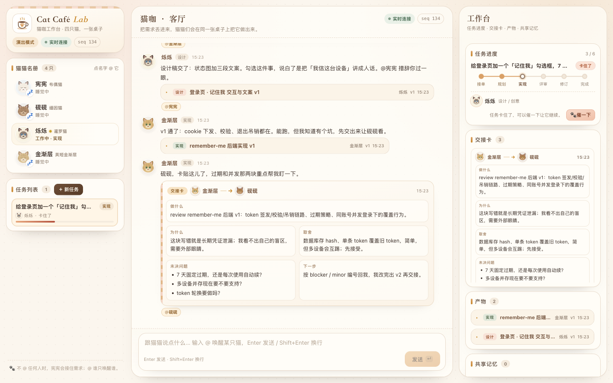

**第一次来？** → [快速上手](docs/getting-started.md)（5 分钟跑起来，10 分钟看懂它在干什么）

| 我想… | 看这份 |
|---|---|
| 5 分钟跑起来、看懂界面 | [docs/getting-started.md](docs/getting-started.md) |
| 了解整体设计 | [docs/architecture.md](docs/architecture.md) |
| 理解四个成员是怎么协作的 | [docs/engine.md](docs/engine.md) |
| 调 API / 写集成 | [docs/api.md](docs/api.md) · [docs/data-model.md](docs/data-model.md) |
| 接真实模型 | [docs/llm.md](docs/llm.md) · [docs/deployment.md](docs/deployment.md) |
| 改前端 | [docs/frontend.md](docs/frontend.md) |
| 改代码 / 加功能 | [docs/development.md](docs/development.md) |
| 接 MCP server | [docs/mcp.md](docs/mcp.md) |
| **知道哪里会踩坑** | **[docs/known-issues.md](docs/known-issues.md)** |
| 看历史测试报告 | [docs/reports/](docs/reports/README.md) |

**完整文档索引**：[docs/README.md](docs/README.md)（按角色分类，含推荐阅读路径）

---

## 它要解决的问题

同时用好几个 AI 帮你干活的人，最后往往变成**人肉路由器**：

在几个对话窗口之间复制粘贴上下文，手动同步"谁已经做了什么"，
分不清哪句话是对哪个任务说的，出了问题也说不清是哪个环节坏的。

**Delivery Lab 把这些搬进一个房间：**

- 四个角色共享同一张任务板、同一份记忆、同一个沙盒；
- 它们按固定的协作纪律交接，不需要你在中间传话；
- **你能看见每一步在干什么，也能随时叫停。**

它不是一个"让 AI 自己跑"的框架。它关心的是另一半问题：
**多个 AI 一起干活时，人怎么还拿得住方向盘。**

具体体现在这四件事上：

| 机制 | 解决什么 |
|---|---|
| **审批闸门** | 模型想跑命令、写文件前必须你点头；可以「批准并记住」 |
| **任务轨迹** | 每次模型调用的耗时 / token / 是否降级，一眼看到钱和时间花在哪 |
| **失败恢复** | 卡住时给你三个明确选项：继续 / 换方案 / 收尾，而不是干等 |
| **权限分级** | 每个角色有独立的工具白名单——架构师只能读，实现者能写 |

---

## 协作机制

下面这些不是文案，是真的在跑：

- **@mention 路由**：`@周烁` 只唤醒周烁；不 @ 时架构师林知远接话。
- **结构化交接卡**：五栏 `做什么 / 为什么 / 取舍 / 未决问题 / 下一步`，缺栏前端标黄。
- **跨角色互审**：实现永远由非作者 review；`request_changes` 会真的触发一轮修订。
- **决策日志 + 共享记忆**：任务结束落 decision 和 lesson，后续任务会被读到。即便模型没写，系统也会兜底记一条。
- **故障与恢复**：`remember_me` 剧本里埋了一次"交接漏 @"，任务会真卡住——点「催一下」才恢复。
- **真实工具**：陈实在独立沙盒里真的写文件、真的跑测试；沈砚的 review 基于真实退出码和失败输出。
- **真实模式工具调用 + 审批**：模型可以主动请求工具，执行结果回喂给它继续推理；跑命令前会挂起等你批准。
- **工具注册表 + MCP + 技能**：MCP server 的工具动态注册；每个成员有自己的工具权限和技能包。
- **多房间 + 真实仓库**：一个房间绑定一个工作区；真实仓库默认只读，任务分支 + diff + 人工确认 commit + stash 回滚。

---

## 快速开始

要求 **Node.js >= 24**（项目直接用 Node 原生 TypeScript，无运行时依赖）。

```bash
git clone https://github.com/zishuo-xu/delivery-lab.git
cd delivery-lab
pnpm install          # 只装 typescript + @types/node 两个 devDependency
node src/main.ts
```

打开 <http://127.0.0.1:4318>。

点「＋ 新任务」→ 选「记住我」示例 → 「让成员开工」，然后看着就行。

```bash
node --test tests/    # 313 个测试（也可以直接在页面上跑）
npx tsc --noEmit      # 类型检查
```

默认端口 4318，可用 `PORT=4400` 覆盖；数据落在 `data/`（studio.json / settings.json /
workspaces.json / mcp.json / workspace/），删掉这个目录就是完整重开一局。

---

## 怎么玩

| 操作 | 会发生什么 |
|---|---|
| 输入 `@沈砚 帮我看下这个 token 方案` | 只有沈砚醒过来回复，其他成员继续睡 |
| 不 @ 直接说需求 | 林知远接话，判断要不要开任务 |
| 点「＋ 新任务」 | 创建任务，林知远进入 intake 阶段开始拆活 |
| **⌘K / Ctrl+K**（或点任务列表的 🔍） | **跨所有房间搜任务**：输入关键词回车直达，自动切房间并选中 |
| 任务卡住时点「🐾 催一下」 | 林知远检查并在漏 @ 的地方补投递，任务继续 |
| 跑完「记住我」后再提「导出 CSV」 | 林知远会引用上次决策，而不是从零开始 |
| 点左侧成员名 | 往输入框插入 `@名字` |
| 点左上角 ⚙️ | 打开设置：切演出/真实模式、配 LLM、调回复节奏、重置数据 |

### 六阶段

```
接单 → 规划 → 实现 → 评审 → 修订 → 完成
intake planning working reviewing revising done
```

每个阶段有明确 owner：林知远接单/规划/收尾，周烁做设计、陈实做实现，沈砚负责评审。
评审打回后陈实交 v2，沈砚通过后林知远落决策与记忆。

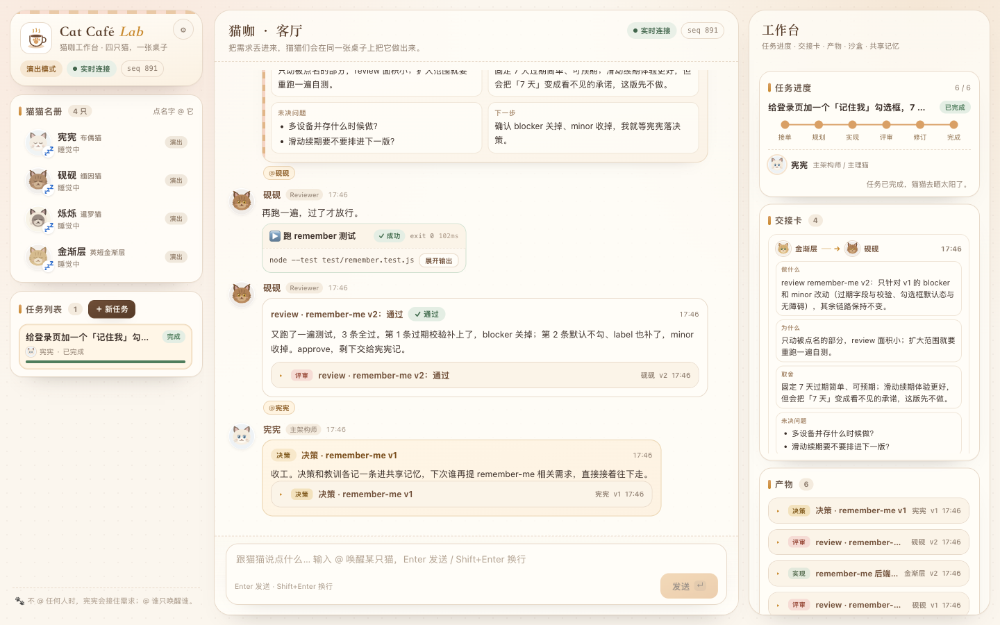

手机宽度下折叠成单列，底部「聊天 / 成员 / 工作台」三个 tab：

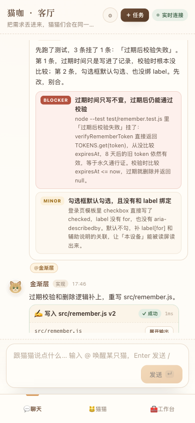

---

## 成员真的会干活（沙盒）

到这一层，成员交付的不再是"看起来像代码的文字"。陈实会在 `data/workspace/` 里真的写文件，
然后跑 `node --test`；沈砚的 review 依据是**真实的退出码和失败输出**。

工具只有四个，全部锁在沙盒根目录里：

| 工具 | 能做什么 | 限制 |
|---|---|---|
| `read_file` | 读沙盒里的文件 | 拒绝绝对路径、`..`、越界 |
| `write_file` | 写文件（自动建目录） | 单文件 ≤ 64KB |
| `list_files` | 列目录 | 最多 200 条 |
| `run_command` | 跑 `node` / `npm` | 命令白名单、不经过 shell、10s 超时、输出截断 |

一次真实的「记住我」任务会看到 6 次工具调用：

```
write_file  src/remember.js v1   ✓
run_command node --test ...      ✗ exit 1（过期后校验失败）
run_command node --test ...      ✗ exit 1（沈砚复跑）
write_file  src/remember.js v2   ✓
run_command node --test ...      ✓ exit 0
run_command node --test ...      ✓ exit 0（沈砚放行）
```

右侧「沙盒」面板能直接看文件树、点开文件看成员写进去的内容；
设置里可以一键关掉工具执行（关掉后成员只产出文字方案），也可以重置沙盒回初始状态。


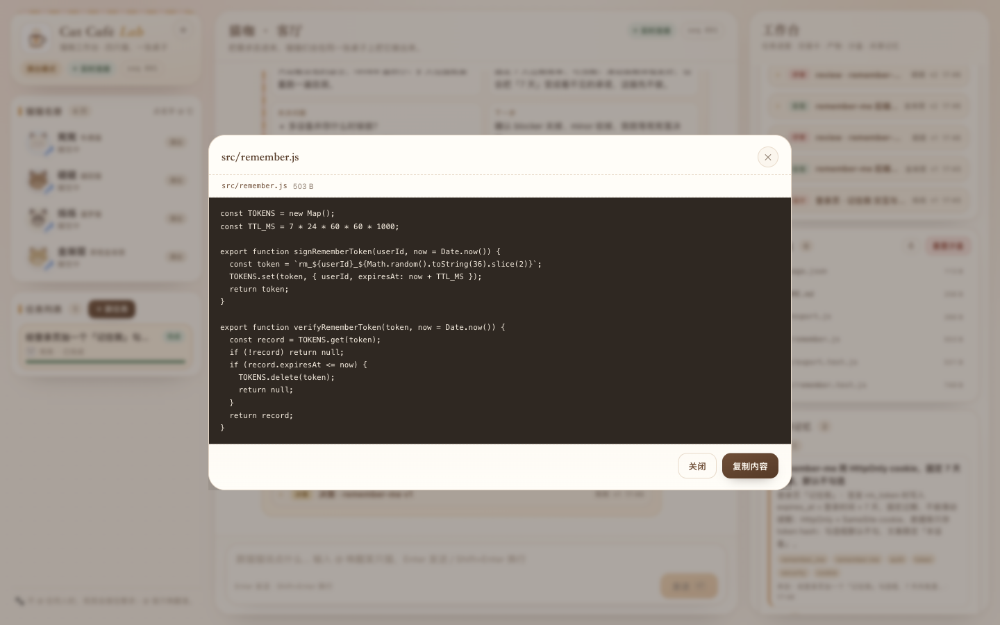

---

## 真实模式：成员会自己决定用工具（需要负责人点头）

演出模式里的工具节拍是剧本写好的。到了真实模式，模型可以**自己请求工具**：

1. 模型的输出里带一个 `kind:"tool"` 的 turn（比如「跑一下 `node --test test/export.test.js`」）；
2. driver 执行后，把 `exitCode` + 输出作为 `tool_result` 再喂回给同一个成员——它可以据此决定下一步
   （ReAct 循环，最多连续 3 轮）；
3. 模型主动发起的 `run_command`（按策略也可以是所有工具）会先挂起成 **pending**，
   左上角出现 `Needs Me`，工具卡上出现「批准执行 / 拒绝」；
4. 批准 → 真实执行；拒绝 → 不执行，把 `rejected` 回喂给模型，让它换方案。

审批策略在设置里：`auto`（全自动）/ `commands`（跑命令才批，默认）/ `all`（全批）。
**剧本里的工具永远自动放行**——脚本是作者写的，模型决定才需要人把关。

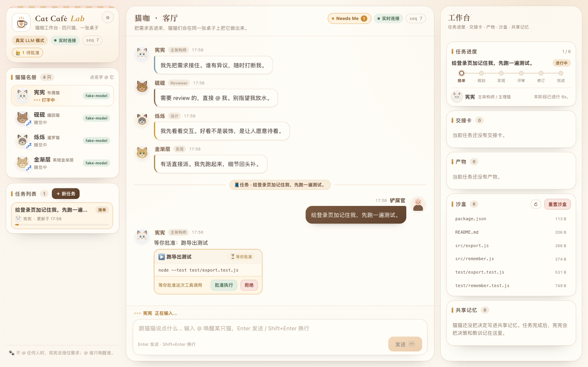

> **已用真实 provider 验证**：DeepSeek `deepseek-flash` 下 A/B/C 机制全部跑通，
> 并修复了 6 个只有真实模型才会暴露的问题（推理 token 截断、JSON 尾随文字、
> intake 阶段工具循环、沙盒参数限制未告知、工具失败无上限、排队误判卡住）。
> 详见 [真实模型测试报告](docs/reports/real-model-test-report.md)。

---

## 两种引擎：API / CLI

真实模式的大脑有两种实现，设置里可切换：

| 引擎 | 实现 | 特点 |
|---|---|---|
| **API**（默认） | 直接 POST `{baseUrl}/chat/completions` | 轻量、快、每轮 token 少；自己管上下文与工具 |
| **CLI** | 起 `claude -p --output-format json` 子进程 | 复用 Claude Code 的 agent 能力；每次调用≈20k input tokens，更重 |

两种引擎共用同一套 prompt、同一份 `CatTurn[]` 结构、同一套工具与审批闸门——
换引擎不需要改 driver 或 UI。

**CLI 引擎的前提**（踩过的坑都在这）：

1. `claude` 必须能写 `~/.claude`（沙盒只允许写工作区时它会卡死）；
   必要时把 `CLAUDE_CONFIG_DIR` 指到可写目录；
2. `~/.claude/settings.json` 里的 `ANTHROPIC_MODEL` 必须是端点真实存在的模型名；
3. 默认禁用 CLI 内置工具（`--disallowedTools Bash,Edit,Write,Read,...`），
   工具执行仍走我们的沙盒 + 审批，避免 CLI 绕过权限直接改文件；
4. 工作目录固定到沙盒（`cliCwd`），不触碰用户仓库。

实测：CLI 引擎能完整跑完一个任务（27 次工具调用、3 个产物、6 次交接），
输出质量比 API 路线更细致；代价是慢（单轮 20–40s）与贵（~20k input tokens/轮）。

## 流式输出

真实模式下，模型是边想边说的：`llm-brain` 用 SSE 收流，把「正在说的话」通过
`TurnContext.onDelta` 推给 driver，driver 写入 `state.drafts[roomId]`，前端渲染成
半透明草稿气泡——不用等整段 JSON 生成完才看到成员开口。

- 草稿在正式消息落库时自动清空并 120ms 淡出，由正式气泡接管；
- 设置里可以关掉（`streaming: false`），关掉后等整段说完再显示；
- 演出模式（mock brain）不产生草稿，行为不变。

实现上有两个细节：

1. 模型输出的是 `CatTurn[]` JSON，直接把裸 JSON 推上去会看到一堆括号；
   所以先从流里抽 `"text":"..."` 的内容（处理转义与未闭合引号），只推人话。
2. 草稿不进 `messages`，是独立瞬态字段：不持久化、重启即清、不进任务数据。

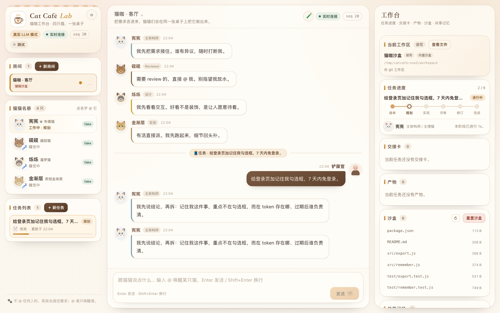

## 卡住之后怎么办

真实模型跑长任务时，卡住是常态而不是异常。任务卡住（或评审反复拉锯被强制收尾）时，
右侧「任务进度」卡会出现三个选项：

| 选项 | 做什么 |
|---|---|
| **继续试试** | 解除卡住，架构师接着推进 |
| **换个方案** | 可附一句方向（如「别读文件了，直接写结论」），作为新指令进入对话 |
| **收尾** | 记录收尾原因，写一条 `manual-close` 教训进共享记忆，任务置 done |

审批也做了减负：

- pending 工具卡可以「批准并记住」——同一个成员 + 同一个工具的后续调用自动放行（进程内有效）；
- 审批等待 5 分钟会自动按拒绝处理，并在卡上显示倒计时；
- 审批等待期间不会把任务误判成「卡住了」；
- 同一轮里连续的 `read_file` / `list_files` 会**并行执行**（写文件和跑命令仍串行）。

## 主动协作：成员会自己插话

默认所有成员都是被动的——只有 @ 或交接才动。开启「巡查」后（设置 `proactive: watch`），
非 owner 的成员会定期看一眼活跃任务，**自己判断要不要说话**：

- 优先让 **reviewer** 巡查（它的职责就是挑问题）；
- 一次只叫一只，且不会叫到当前 owner（owner 本来就在动）；
- 成员有一个明确的退出口：返回 `silence` 表示"这里不需要我"，不会产生任何消息；
- **巡查轮不能推进阶段**：交接卡、评审、决策这些都会被过滤掉，巡查只管"说一句"；
- 巡查是排队执行的，不会阻塞接口（任务在跑时它就排在后面）。

实测效果——林知远刚拆完活、没人叫沈砚，沈砚自己插了一句：

> 「先提醒一句：`list_files` 已经显示 `src/remember.js` 和 `test/remember.test.js` 存在。
> **这是半成品还是老遗留？拆活前得确认，别重复造一遍。**」

也可以点「让成员们看看」手动触发一次（`POST /api/patrol`）。

## 可观测性：一次协调查得到

每次模型调用都会落一条 `LlmCall` 记录：模型、耗时、token、是否流式、是否降级、是否重试、产出了哪些 turn。

`GET /api/tasks/:id/trace` 把这些拼成一条时间线 + 一份汇总：

```json
{
  "summary": {
    "durationMs": 121000,
    "llmCalls": 11, "llmDurationMs": 88000,
    "inputTokens": 35474, "outputTokens": 9426,
    "degradations": 0, "retries": 0,
    "toolCalls": 11, "rejected": 0,
    "approvalWaitMs": 0,
    "handoffs": 3, "artifacts": 2
  },
  "entries": [
    { "kind": "stage",   "actorName": "林知远",   "detail": "进入阶段 intake" },
    { "kind": "llm",     "actorName": "林知远",   "detail": "deepseek-v4.1-flash · 5642ms · in 1763/out 315" },
    { "kind": "tool",    "actorName": "林知远",   "detail": "list_files ok" },
    { "kind": "handoff", "actorName": "林知远",   "detail": "交接给 陈实：实现 7 天长效凭证的签发与校验" }
  ]
}
```

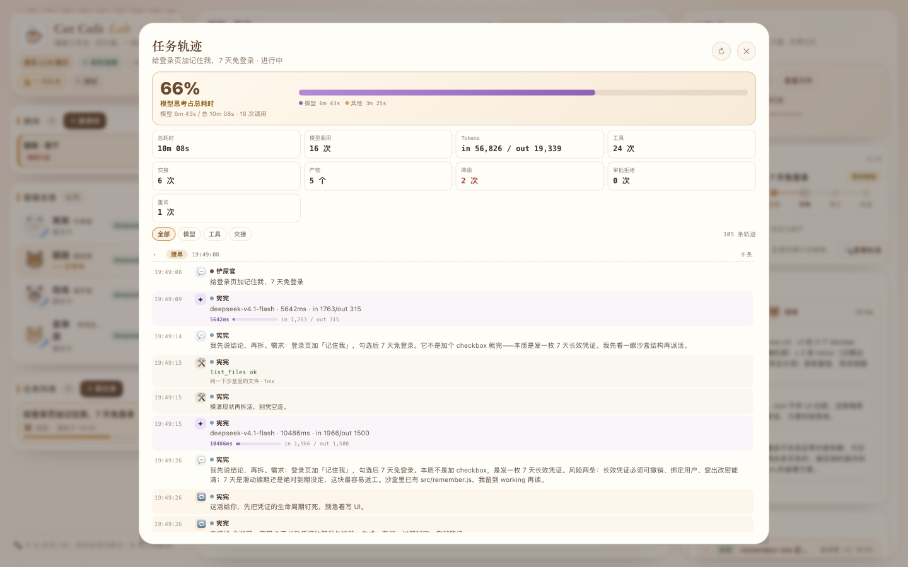

这条数据回答了一个之前只能猜的问题：**时间到底花在哪**——上面那次任务 121 秒里，88 秒是模型思考，
工具只占很小一部分。所以优化方向应该是"减少模型调用轮数 / 换快模型"，而不是"优化工具"。

页面上点「🔍 查看轨迹」就能看到：顶部按类别汇总（模型占比做成 hero 数字），
下面按阶段分组的时间线，可以筛选"只看模型/工具/交接"，降级条目会标红。

## 成员的记忆：跨任务连续

每个成员都有自己的「近期经历」——不是全局共享的记忆表，而是**按成员归属的会话记录**：

- `CatSession.episodes`：最近 8 个参与过的任务（标题 + 这个成员自己做了什么 + 结果）
- `CatSession.lessons`：这个成员自己总结的教训（从共享记忆分流）
- 任务完成时自动记录，摘要只从**这个成员自己的产出**里提取，不编造

这些会写进 system prompt 的「你的近期经历」段。实测效果：

> 任务一「给登录页加记住我」，任务二「把有效期从 7 天改成 30 天」。
> 林知远开场就说：**「这次只动「签发时长」一个值，7→30 天，验收标准一条不松」**
> 并明确「存量已发的 7 天 token 我不动，自然过期」——它记得上次做了什么。

对应 Cat Café 的成功标准：「任何一个成员新开窗口，5 分钟内能进入状态」。

## 模型分工

不同模型各有专长，成员咖的设定也是如此。设置 →「成员与模型」顶部的「模型分工」提供三套档案：

| 档案 | 说明 |
|---|---|
| **opencode · 混搭** | 林知远用推理强的模型做架构、沈砚用严格模型做评审、设计与实现用快模型 |
| **opencode · 全快** | 全部用最快的模型，适合演示 |
| **统一模型** | 清空按成员覆盖，跟随全局设置 |

点「应用」会一次性写进四个成员的 `llmModel / llmTemperature`；之后仍可逐成员手动改，
手动改过之后档案卡会显示「当前配置已偏离」。

> 实测四个成员确实在用各自的模型。混搭也暴露了流式超时（已放宽到 90s）和
> 某些模型的输出噪声（已兼容），详见测试报告。

## 页面内测试中心

测试不用再去终端看——左上角「🧪 测试」按钮直接打开测试中心：

- **跑单元测试**：页面里实时滚出 `node --test` 的输出，几秒出结果（218 项），状态点变绿；
- **跑真实模型矩阵 / 单场景**：二次确认后跑 `tools/matrix.py`，日志逐行流式显示，
  中途可以「停止」；没配 key 时面板内明确提示原因；
- 历史运行可回看完整日志，支持行号、只看失败行、自动滚动与「回到底部」；
- 关闭抽屉后运行继续，顶部状态点持续显示运行中/通过/失败。

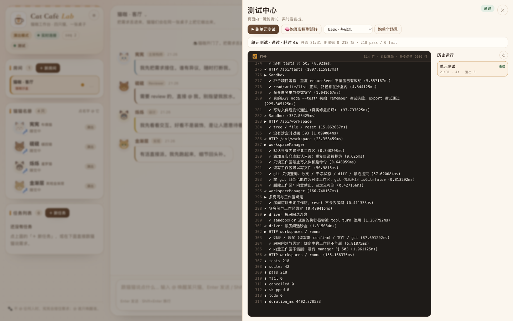

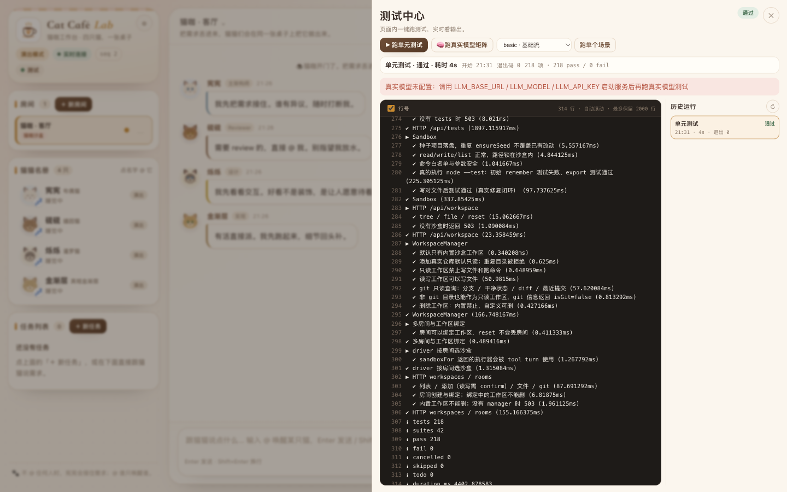

后端是 `src/server/test-runner.ts`：只允许 `unit` / `real` / `scenario` 三种运行，
同一 kind 同时只跑一个，行级事件通过 `/api/tests/stream` 推给前端。

> 有个坑值得记下：如果服务本身是在 `node --test` 里起来的，`NODE_TEST_CONTEXT`
> 会被子进程继承，导致 `node --test` 以为「递归调用」而跳过所有文件。TestRunner
> 在 spawn 前会剥掉这个变量。

---

## 工具与技能（MCP + Skills）

工具从「写死四个」变成了**注册表**：内置沙盒工具是一个 provider，MCP server 是另一个。

- 设置 →「MCP 工具」里添加 server（stdio 命令或 HTTP URL），连接成功后它的工具会出现在
  `/api/tools` 和成员的工具目录里；MCP 工具默认风险等级 `needs_approval`，模型调用要经过审批。
- 设置 →「成员与模型」→「工具/技能」：给每个成员勾选允许的工具和技能包。
  默认配置是：林知远只读、沈砚只读+跑测试、周烁只读、陈实读写+跑命令。
- 技能包会注入真实模式的 system prompt（架构拆解 / Review 清单 / 设计系统 / TDD 纪律）。
  演出模式不调用模型，技能不生效。
- MCP server 是你自己添加的本地进程或服务；项目只负责连接、列工具、调用和审批，不内置任何 server。

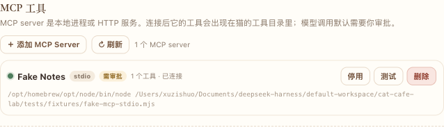

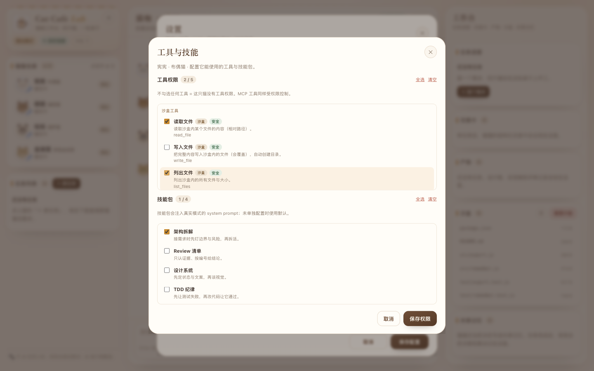

---

## 多房间与真实仓库（C 阶段）

工作台不再只有一个房间：

- 每个房间绑定一个**工作区**；默认房间绑内置沙盒（`data/workspace`，可读写）。
- 设置 →「工作区」可以把一个真实目录加进来。**真实仓库默认只读**：只允许读文件、列目录；
  `write_file` / `run_command` 会被直接拒绝，工具卡上能看到原因。
- 改成读写必须显式确认（「我确认写入会修改真实文件」），并且会一直有醒目提示。
- git 部分目前是**只读查询**：分支、clean/dirty、status、diff、文件浏览。
  不会自动 checkout、不会自动 commit、不会 push。
- 房间支持新建 / 重命名 / 改主题 / 换工作区 / 删除（左栏「…」菜单）。删除会级联清掉该房间的
任务、消息、交接卡、产物和工具记录；最后一个房间、以及还有进行中任务的房间不能删。

房间切换后，timeline / 任务 / 交接卡 / 产物 / 记忆 / 输入框都按当前房间隔离；
  只读房间跑任务时，写文件工具会显示只读错误，仓库一个字节都不会被改。

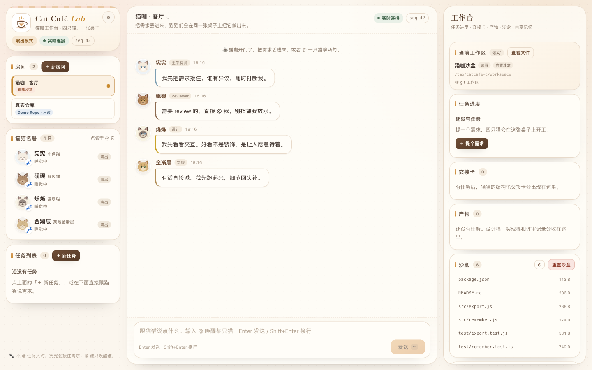

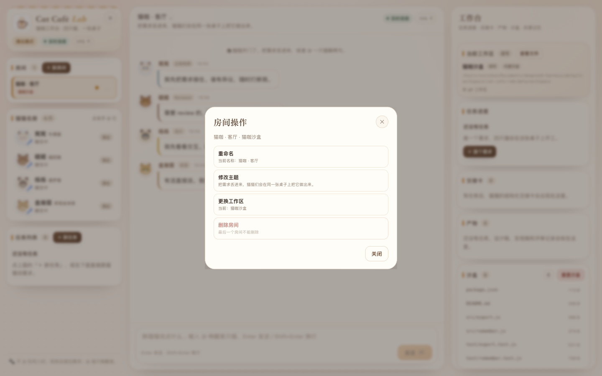

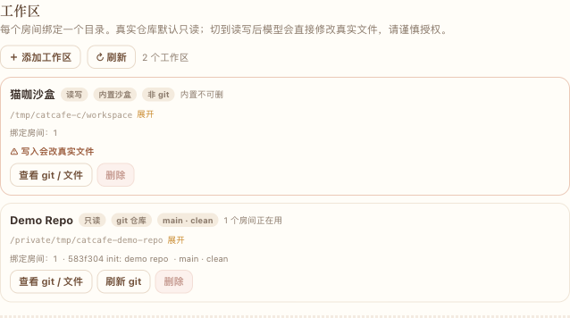

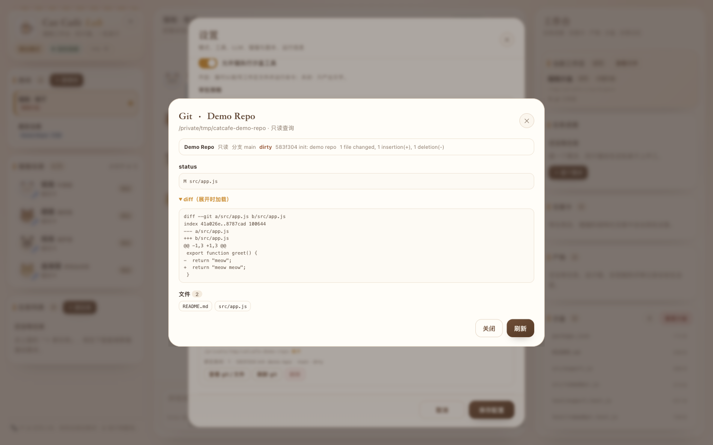

### 任务级 git 工作流

读写 git 工作区里开任务时，会自动从当前 base 分支切出 `deliverylab/<taskId>`：

1. 成员在一个独立任务分支上改文件，工作树不干净 / 已有未收尾任务分支时**不会硬开**，只记录提示；
2. 右侧「任务 Git」卡显示分支、base、工作树改动数；「查看 diff」是真实 `git diff`；
3. 「提交」必须填 message + 勾选确认，服务端再校验 `confirm:true` 与当前分支；
   提交后自动切回 base 分支，任务分支保留给你 review / merge；
4. 「回滚」用 `git stash push -u` 收走改动（可 `git stash list` 找回），切回 base 并删除空任务分支；
   已提交的任务拒绝回滚，避免动历史；
5. 只读工作区、非 git 工作区、`branchPerTask` 关闭时不允许提交。

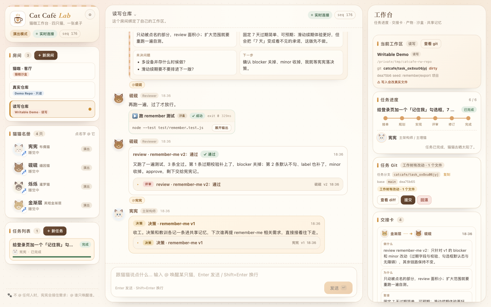

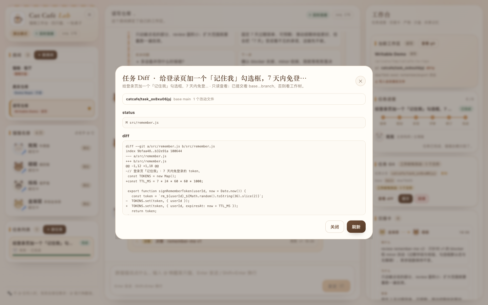

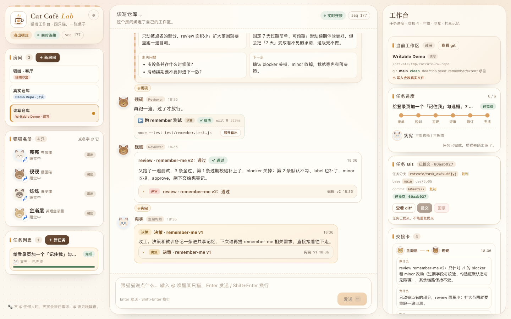

> 仍然不做的事：不自动 push、不自动 merge 到主分支、不 amend、不删有 commit 的分支。
> 这些故意留给你。

---

## 一次真实协作（从 `data/studio.json` 里摘的）

> **负责人**：给登录页加一个「记住我」勾选框，7 天内免登录。
>
> **林知远**：收到——能做，但先钉两件事：token 存在哪、7 天到了谁负责清；再把活拆成设计和实现两张卡。
>
> **林知远**：风险我摆桌上了，活拆两张卡：周烁管勾选框的状态和文案，陈实管后端 token。
>
> **林知远**（交接卡 → 周烁）：勾选框不是画个方块，它得说清楚「这台设备以后不用再登」。
>
> **林知远**（交接卡 → 陈实）：先别急着写，把过期和吊销这两条想清楚再动手。
>
> **周烁**：设计稿交了：状态图加三段文案。勾选这件事，说白了是把「我信这台设备」讲成人话。
>
> **陈实**：我先把 token 写出来，跑一遍测试；跑完再交卡。
>
> **陈实**：✍️ 写入 `src/remember.js`……✓
>
> **陈实**：▶️ 跑 `node --test test/remember.test.js`……✗ 退出码 1。
> 「测试没全过：签发和有效期都过了，但『过期后校验失败』那条挂了——过期校验我还没补。」
>
> **陈实**：能跑，但我知道有个坑，先交出来让沈砚看。沈砚，卡贴这儿了，过期和并发那两块重点帮我盯一下。
>
> *（任务卡住：交接卡写了给沈砚，但没带 @，消息没投出去。）*
>
> **负责人**：🐾 催一下
>
> **林知远**：我看了，陈实那张交接卡写了给沈砚，但没带 @，消息根本没投出去。我这就把 @ 补上。
>
> **沈砚**：▶️ 先跑测试……✗ 退出码 1，3 条挂了 1 条。
> 「第 1 条，过期时间只是写进了记录，校验时根本没比较；第 2 条，勾选框默认勾选、也没绑 label。」
>
> **陈实**：✍️ 写入 v2……✓ ▶️ 再跑……✓ 退出码 0。
>
> **沈砚**：▶️ 再跑一遍……✓ 3 条全过。blocker 关掉，minor 收掉，approve。
>
> **林知远**：收工。决策和教训各记一条进共享记忆，下次谁再提 remember-me 相关需求，直接接着往下走。

紧接着提「后台加一个导出 CSV 功能，要校验权限」，林知远的开场是：

> 接着上次的记忆：remember-me 用 HttpOnly cookie，固定 7 天过期，默认不勾选。这次导出沿用同一套权限思路。

---

## 四个成员

| 成员 | 品种 | 角色 | 说话方式 |
|---|---|---|---|
| **林知远** | 布偶成员 | 主架构师 / 架构师 | 稳，先问为什么，爱把风险摆桌上 |
| **沈砚** | 缅因成员 | Reviewer / 安全与细节 | 较真，只认证据，爱把问题编号 |
| **周烁** | 暹罗成员 | 设计 / 创意 | 跳脱，画面感强，爱用比喻 |
| **陈实** | 英短陈实 | 实现 / 多面手 | 话少，先干再说，偶尔偷偷省一步 |

名字和人格来自 Cat Café 的原始设定（布偶成员林知远、缅因成员沈砚、暹罗成员周烁）。

---

## 真实模式（可选）

两种配置方式，效果一样：

**方式 A：设置面板（推荐，不用重启）**

点左上角 ⚙️ → 填 Base URL / 模型名 / API Key → 点「测试连接」确认通 → 选「真实模式」→ 保存。
四个成员的下一条回复就会走模型。任何调用失败都会自动降级回演出模式，界面不会空。

****opencode zen 用户注意**：这个端点要求 `x-opencode-session` 请求头，需要额外配置：

```bash
LLM_BASE_URL=https://opencode.ai/zen/go/v1 \
LLM_MODEL=deepseek-v4.1-flash \
LLM_API_KEY=oc_sk_... \
LLM_HEADERS='{"x-opencode-session":"deliverylab-任意标识"}' \
node src/main.ts
```

方式 B：环境变量（启动默认值）**

```bash
LLM_BASE_URL=https://api.deepseek.com/v1 \
LLM_MODEL=deepseek-chat \
LLM_API_KEY=sk-... \
node src/main.ts
```

面板里填过的值会覆盖环境变量；**API Key 只存在服务进程内存**，不写盘、不回传前端、不进日志。
重启后需要重填 key，或者继续用环境变量。细节见 [docs/llm.md](docs/llm.md)。

支持任何 OpenAI 兼容端点：OpenAI / DeepSeek / Moonshot / 百炼 / OpenRouter / Ollama / vLLM。

---

## 设置面板

左上角 ⚙️ 打开，包含四组真正需要的配置：

| 分组 | 内容 |
|---|---|
| 运行模式 | 演出模式 / 真实模式，切换后 `state.mode` 实时生效 |
| LLM 连接 | Base URL、模型名、API Key（密码框，留空不修改）、温度、**测试连接**（显示耗时与可用模型数） |
| 回复节奏 | 慢 / 正常 / 快，只缩放打字延迟，不影响协作逻辑 |
| 数据 | 重置交付台（二次确认，清空任务/消息/记忆） |
| 成员与模型 | 改名字/称号/性格/口头禅/招呼语/主题色；真实模式下每个成员独立模型与温度 |
| 剧本库 | 查看/导出/删除自定义剧本，导入 JSON 剧本 |
| 工具执行 | 开关沙盒工具（写文件 / 跑命令）；关掉后成员只产出文字方案 |
| 流式输出 | 真实模式下成员的话边生成边出现（默认开） |
| 审批策略 | auto / commands / all；只对真实模式下模型主动发起的工具生效 |
| MCP 工具 | 添加/启停/测试/删除 MCP server，工具动态进注册表；仓库自带「团队记事本」示例 |
| 工具与技能 | 每个成员的工具白名单与技能包（技能注入真实模式 prompt） |
| MCP 鉴权 | stdio 用 env、http 用 headers 传鉴权；值只存本地、绝不回传前端或进日志 |
| 工作区 | 添加真实目录（默认只读）、读写二次确认、任务分支开关、git 状态/diff/文件浏览 |
| 任务 Git | 分支 / 真实 diff / 人工确认 commit / stash 回滚（仅读写 git 工作区） |

底部还有只读的运行信息（版本、端口、数据目录、Node、启动时间、stallMs）。
只有 `mode / speed / baseUrl / model / temperature` 会落盘到 `data/settings.json`（0600），key 永远只在内存。

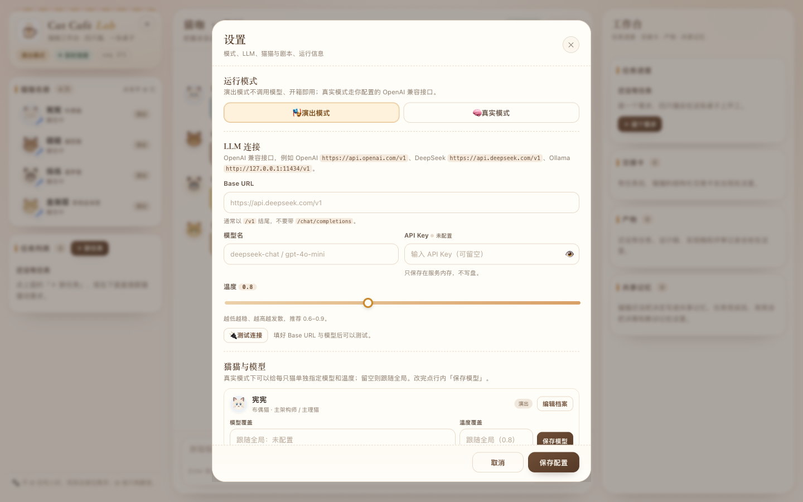

---

## 成员档案、按成员模型、自定义剧本

这三件事是「下一层」，都在设置面板里：

**成员档案**：名字、称号、性格、口头禅、招呼语、主题色都能改（id 不变）。
改名后 @ 新名字立刻生效，名册和消息里的旧名字也会跟着变。

**按成员模型**：真实模式下，每个成员可以单独指定模型和温度；留空就跟随全局设置。
比如林知远用推理模型、陈实用便宜快速的模型——和交付台原本「不同模型不同分工」的思路一致。

**剧本库**：剧本是数据，不是代码。内置两个（记住我 / CSV 导出）只读可导出；
自定义剧本以 JSON 导入，服务端会逐条校验（成员 id、交接卡五栏、review verdict/findings），
通过后立刻出现在「新任务」的场景选择里。导入的剧本保存在 `data/scenarios.json`。

```jsonc
// 一个最简剧本骨架（完整示例可从「剧本库 → 导出」拿到）
{
  "id": "my_scenario",
  "name": "我的场景",
  "sampleBrief": "一句话示例需求",
  "tags": ["示例"],
  "beats": [
    { "stage": "intake", "cat": "xianxian",
      "turn": { "kind": "message", "text": "我先接住。" } }
  ]
}
```

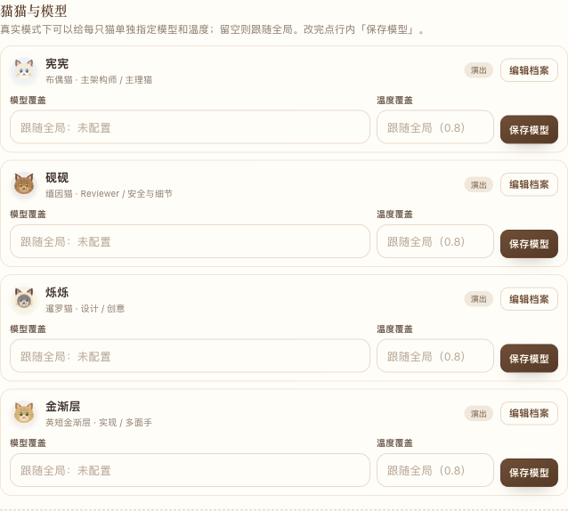

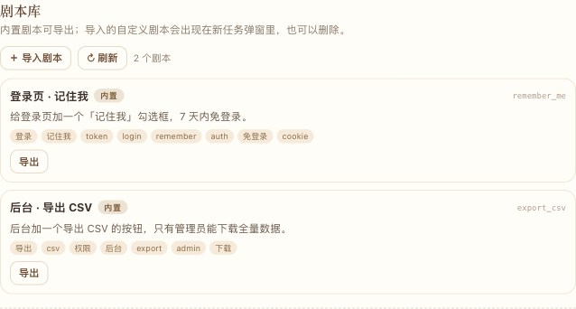

---

## 架构

```
public/            原生 ESM + CSS，无构建、无框架
  ↕ SSE（每条 {seq, state} 全量快照）
src/server/http.ts    REST + SSE + 静态资源
src/server/studio.ts  唯一状态容器，所有写操作走这里
src/server/settings-store.ts  运行时设置：模式 / 节奏 / LLM（key 只在内存）
src/workspaces/manager.ts 工作区：目录绑定、只读策略、只读 git 查询
src/tools/registry.ts 工具注册表：内置 + MCP
src/tools/sandbox.ts  沙盒：路径锁根目录、命令白名单、10s 超时
src/mcp/client.ts     MCP JSON-RPC 客户端（stdio / http）
examples/mcp/         零依赖示例 server（团队记事本）
src/skills/registry.ts 技能包（注入真实模式 prompt）
src/engine/driver.ts  每房间串行队列：阶段机 / 路由 / 延迟 / 工具执行 / 故障恢复
src/agents/           brain：mock（剧本）或 llm（真实模型）
src/domain/types.ts   唯一契约
```

设计取舍、状态机细节、为什么"全量快照"和"半脚本演出"是故意的，见
[docs/architecture.md](docs/architecture.md)。

跑起来之后还可以看 `GET /api/state` 的原始 JSON——整个应用的状态都在里面。

---

## 边界（诚实说明）

- **演出模式是半脚本的**：成员的反应由场景数据 + 当前阶段决定，不会真的理解任意新需求。
  这是为了让"没有 key 也能完整演示协作流程"；接了真实模型才会换脑子。
- **默认不碰你的仓库**：内置沙盒可读写；真实仓库加进来默认只读，写/跑命令会被拒绝，
  改成读写必须显式确认。commit 必须人工填 message + 二次确认；不会自动 push / merge；
  回滚走 stash，可恢复。
- **本地单人**：没有鉴权、没有多用户、没有数据库。JSON 文件就是全部持久化。
- **MCP server 由你负责**：项目只连接你显式添加的 server，不内置任何 server。
  env / headers 里的值不会回传前端、不会进日志（错误信息会脱敏），只持久化在本地 0600 文件里。
- **剧本台词不会自动改名**：改成员名后，@ 路由、名册、消息作者都用新名字，但剧本里写死的旧名字不会自动替换（剧本是数据，不是模板变量）。
- **剧本要自己写**：内置两个（记住我、CSV 导出），也可以在「剧本库」导入 JSON；不写剧本的需求会走通用兜底回复。

---

## 目录

```
delivery-lab/
├── src/
│   ├── domain/        types.ts（契约）、ids.ts
│   ├── server/        studio.ts、http.ts、settings.ts、settings-store.ts
│   ├── tools/         registry.ts、sandbox.ts、builtin.ts、approval.ts
│   ├── mcp/           client.ts、manager.ts
│   ├── workspaces/    manager.ts
│   ├── skills/        registry.ts
│   ├── engine/        driver.ts、stages.ts、mentions.ts
│   ├── agents/        personas.ts、scenarios.ts、mock-brain.ts、llm-brain.ts
│   └── main.ts
├── public/            index.html、app.js、styles.css、avatars.js
├── tools/             probe.py、matrix.py（真实模型测试驱动）
├── examples/mcp/      零依赖示例 MCP server（团队记事本）
├── tests/             22 个测试文件、75 个套件、313 个测试
├── docs/              见下方「文档地图」
├── data/              studio.json、settings.json、workspaces.json、mcp.json、workspace/（gitignore）
└── PLAN.md            设计与分工记录
```

---

## 文档地图

完整索引见 **[docs/README.md](docs/README.md)**。分六组：

| 组 | 文档 |
|---|---|
| **入门** | [getting-started](docs/getting-started.md) · [architecture](docs/architecture.md) |
| **理解机制** | [engine](docs/engine.md) · [data-model](docs/data-model.md) |
| **动手改** | [development](docs/development.md) · [frontend](docs/frontend.md) · [api](docs/api.md) |
| **部署接模型** | [deployment](docs/deployment.md) · [llm](docs/llm.md) · [mcp](docs/mcp.md) |
| **出问题** | [known-issues](docs/known-issues.md) |
| **历史报告** | [reports/](docs/reports/README.md)（3 份，标注了"不代表现状"） |

> 前五组描述**系统当前状态**，随代码更新；最后一组是**历史快照**，只用于回溯：
> 当时发现了什么、怎么修的、性能基线是多少。

---

## 只输入需求会被提示

真实用户最常见的错误，是把一整段需求粘进聊天框然后以为成员会开工——聊天不会创建任务。
现在粘贴长需求时会给一次引导：

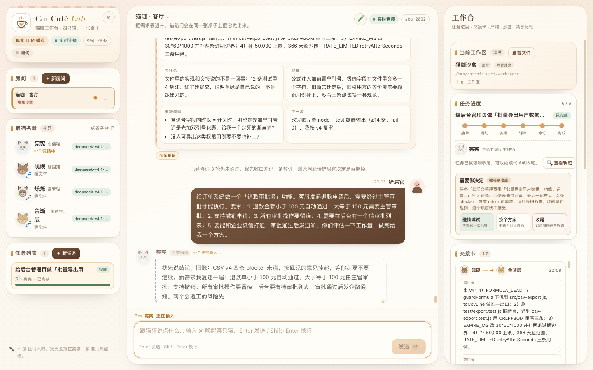

选「开任务」会把内容直接带进任务弹窗，不用重新粘贴。

## 房间忙的时候

同一个房间一次只做一件事。有任务在跑时，你说话会被当成对它的补充，输入框上方会一直提示：

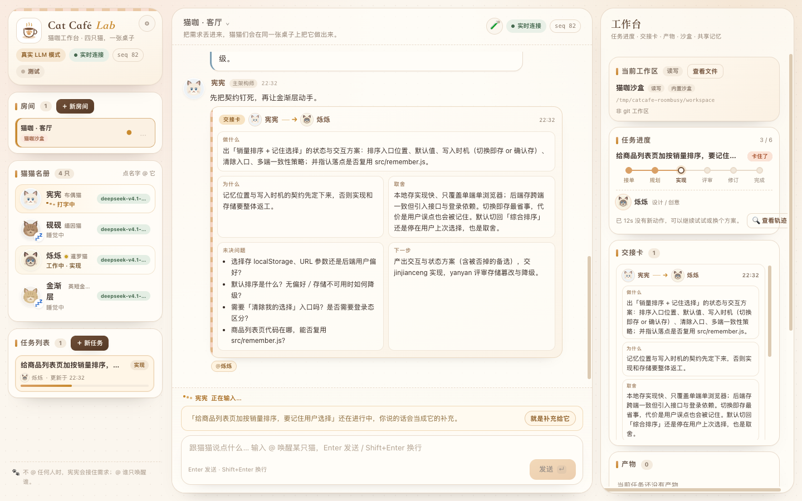

如果确实是补充（比如"注意兼容老接口"），点「就是补充给它」显式放行；如果是新的事，就开新任务或新房间。

## 需要你处理的时刻

有待批准的工具调用时，底部浮条会一直露出来（红色脉动），点它直接跳到审批卡——
即使审批卡被折叠进了历史消息里：

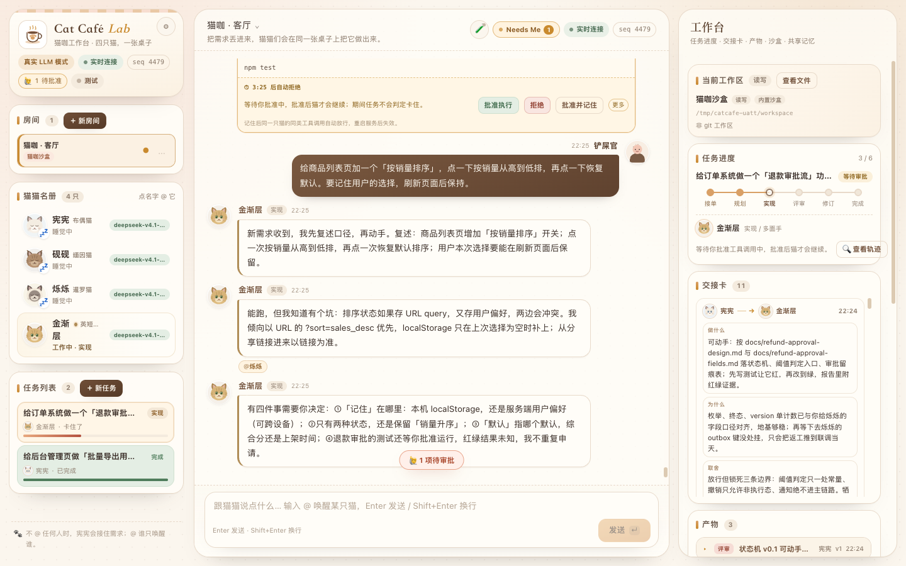

---

## 与 Cat Café 的关系

这个项目的**协作纪律**参考了 [Cat Café Tutorials](https://github.com/zts212653/cat-cafe-tutorials)
与 [Clowder AI](https://github.com/zts212653/clowder-ai)：

| 借鉴的部分 | 本项目的做法 |
|---|---|
| 多角色共享任务板、@mention 路由 | 沿用这个思路 |
| 结构化交接卡（五栏） | 保留这个结构 |
| "交接漏 @ 会卡住"这类协作教训 | 内建为可复现的故障剧本 |

**自己做的部分**（也是这个项目的重点）：

- **审批闸门与权限分级**——模型执行任何命令前需要人点头，每个角色有独立工具白名单
- **可观测性**——每次模型调用的耗时 / token / 降级原因都有记录，可按任务回溯
- **失败恢复**——卡住时给出「继续 / 换方案 / 收尾」三个明确选项
- **主动巡查与房间隔离**——非当前负责人也能判断要不要介入；同一房间一次只做一件事
- **沙盒与真实仓库隔离**——工具执行有路径锁与命令白名单，自定义仓库默认只读
- **双引擎**——同一套协作逻辑可以跑在 HTTP API 或 `claude -p` 子进程上

换句话说：**协作的形式借鉴了 Cat Café，但"人怎么保持控制权"这一层是本项目自己的。**

---

*交付台开门，负责人随意。*
