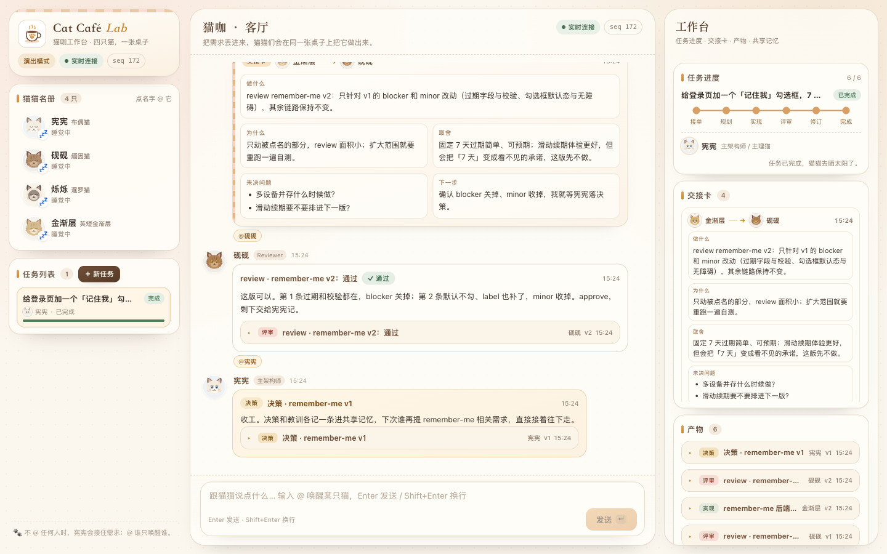

# Cat Café Lab · 猫咖工作台

**铲屎官提一句需求，四只猫在同一个房间里把它做出来。**
你能看见它们怎么拆活、怎么 @ 对方、怎么交接、怎么互相挑刺、怎么把决定记进共享记忆。

一个本地 Web 应用。**不需要任何 API key**——内置一套确定性的猫猫演出，打开就能看完一次完整协作。
配好模型后可以切换成真实 LLM。


---

## 为什么做这个

参考的是 [Cat Café / Clowder AI](https://github.com/zts212653/clowder-ai)：一个人同时用 Claude、GPT、Gemini，
结果自己变成了**人肉路由器**——在聊天窗口之间复制粘贴上下文，手动追踪谁说了什么。
猫咖要解决的就是这件事：让猫猫们共享同一个房间、同一张任务板、同一套记忆，自己协作。

这个项目不是 Clowder 的复刻，也不是通用 Agent 框架。它只做一件事：
**把猫咖那套协作纪律做成一个看得见、点得动的工作台。**

具体来说，下面这些机制都是真的在跑，不是文案：

- **@mention 路由**：`@烁烁` 只唤醒烁烁，其他猫睡觉；不 @ 时宪宪接话。
- **结构化交接卡**：五栏 `做什么 / 为什么 / 取舍 / 未决问题 / 下一步`，缺栏前端标黄。
- **跨猫互审**：实现永远由非作者 review；`request_changes` 会真的触发一轮 revise。
- **决策日志 + 共享记忆**：任务结束宪宪落 decision 和 lesson，后续任务会被大脑读到。
- **故障与恢复**：`remember_me` 剧本里埋了一次"交接漏 @"，任务会真卡住——点「催一下」才恢复。

---

## 快速开始

要求 **Node.js >= 24**（项目直接用 Node 原生 TypeScript，无运行时依赖）。

```bash
cd cat-cafe-lab
pnpm install          # 只装 typescript + @types/node 两个 devDependency
node src/main.ts      # 或 pnpm start
```

打开 <http://127.0.0.1:4318>。

点「＋ 新任务」→ 选「记住我」示例 → 「让猫猫开工」，然后看着就行。

```bash
node --test tests/    # 59 个测试
npx tsc --noEmit      # 类型检查
```

默认端口 4318，可用 `PORT=4400` 覆盖；数据落在 `data/studio.json`，删掉就是重开一局。

---

## 怎么玩

| 操作 | 会发生什么 |
|---|---|
| 输入 `@砚砚 帮我看下这个 token 方案` | 只有砚砚醒过来回复，其他猫继续睡 |
| 不 @ 直接说需求 | 宪宪接话，判断要不要开任务 |
| 点「＋ 新任务」 | 创建任务，宪宪进入 intake 阶段开始拆活 |
| 任务卡住时点「🐾 催一下」 | 宪宪检查并在漏 @ 的地方补投递，任务继续 |
| 跑完「记住我」后再提「导出 CSV」 | 宪宪会引用上次决策，而不是从零开始 |
| 点左侧猫名 | 往输入框插入 `@名字` |

### 六阶段

```
接单 → 规划 → 实现 → 评审 → 修订 → 完成
intake planning working reviewing revising done
```

每个阶段有明确 owner：宪宪接单/规划/收尾，烁烁做设计、金渐层做实现，砚砚负责评审。
评审打回后金渐层交 v2，砚砚通过后宪宪落决策与记忆。



手机宽度下折叠成单列，底部「聊天 / 猫猫 / 工作台」三个 tab：


---

## 一次真实协作（从 `data/studio.json` 里摘的）

> **铲屎官**：给登录页加一个「记住我」勾选框，7 天内免登录。
>
> **宪宪**：收到——能做，但先钉两件事：token 存在哪、7 天到了谁负责清；再把活拆成设计和实现两张卡。
>
> **宪宪**：风险我摆桌上了，活拆两张卡：烁烁管勾选框的状态和文案，金渐层管后端 token。
>
> **宪宪**（交接卡 → 烁烁）：勾选框不是画个方块，它得说清楚「这台设备以后不用再登」。
>
> **宪宪**（交接卡 → 金渐层）：先别急着写，把过期和吊销这两条想清楚再动手。
>
> **烁烁**：设计稿交了：状态图加三段文案。勾选这件事，说白了是把「我信这台设备」讲成人话。
>
> **金渐层**：v1 通了：cookie 下发、校验、退出吊销都在。能跑，但我知道有个坑，先交出来让砚砚看。
>
> **金渐层**：砚砚，卡贴这儿了，过期和并发那两块重点帮我盯一下。
>
> *（任务卡住：交接卡写了给砚砚，但没带 @，消息没投出去。）*
>
> **铲屎官**：🐾 催一下
>
> **宪宪**：我看了，金渐层那张交接卡写了给砚砚，但没带 @，消息根本没投出去。我这就把 @ 补上。
>
> **砚砚**：看完了，不通过。第 1 条，token 表没有过期时间，7 天免登录实际变成了永久免登录；
> 第 2 条，勾选框默认勾选、也没绑 label，读屏用户不知道这是什么。
>
> **金渐层**：改完了。过期字段、校验、默认不勾、label 都补了。
>
> **砚砚**：这版可以。blocker 关掉，minor 收掉，approve。
>
> **宪宪**：收工。决策和教训各记一条进共享记忆，下次谁再提 remember-me 相关需求，直接接着往下走。

紧接着提「后台加一个导出 CSV 功能，要校验权限」，宪宪的开场是：

> 接着上次的记忆：remember-me 用 HttpOnly cookie，固定 7 天过期，默认不勾选。这次导出沿用同一套权限思路。

---

## 四只猫

| 猫 | 品种 | 角色 | 说话方式 |
|---|---|---|---|
| **宪宪** | 布偶猫 | 主架构师 / 主理猫 | 稳，先问为什么，爱把风险摆桌上 |
| **砚砚** | 缅因猫 | Reviewer / 安全与细节 | 较真，只认证据，爱把问题编号 |
| **烁烁** | 暹罗猫 | 设计 / 创意 | 跳脱，画面感强，爱用比喻 |
| **金渐层** | 英短金渐层 | 实现 / 多面手 | 话少，先干再说，偶尔偷偷省一步 |

名字和人格来自 Cat Café 的原始设定（布偶猫宪宪、缅因猫砚砚、暹罗猫烁烁）。

---

## 真实模式（可选）

不配任何东西时是**演出模式**：台词来自 `src/agents/scenarios.ts` 里的剧本，确定、离线、可测试。

想让四只猫真的用模型说话，设置三个环境变量再启动：

```bash
LLM_BASE_URL=https://api.deepseek.com/v1 \
LLM_MODEL=deepseek-chat \
LLM_API_KEY=sk-... \
node src/main.ts
```

支持任何 OpenAI 兼容端点（OpenAI / DeepSeek / Moonshot / 百炼 / OpenRouter / Ollama / vLLM）。
左上角会变成「真实模式」。**任何调用失败都会降级回演出模式**，界面不会空。
细节、输出契约和隐私说明见 [docs/llm.md](docs/llm.md)。

---

## 架构

```
public/            原生 ESM + CSS，无构建、无框架
  ↕ SSE（每条 {seq, state} 全量快照）
src/server/http.ts    REST + SSE + 静态资源
src/server/studio.ts  唯一状态容器，所有写操作走这里
src/engine/driver.ts  每房间串行队列：阶段机 / 路由 / 延迟 / 故障恢复
src/agents/           brain：mock（剧本）或 llm（真实模型）
src/domain/types.ts   唯一契约
```

设计取舍、状态机细节、为什么"全量快照"和"半脚本演出"是故意的，见
[docs/architecture.md](docs/architecture.md)。

跑起来之后还可以看 `GET /api/state` 的原始 JSON——整个应用的状态都在里面。

---

## 边界（诚实说明）

- **演出模式是半脚本的**：猫的反应由场景数据 + 当前阶段决定，不会真的理解任意新需求。
  这是为了让"没有 key 也能完整演示协作流程"；接了真实模型才会换脑子。
- **猫交付的不是可执行代码**：spec / design / patch 摘要，不会真的改你的仓库。
  这个项目的目标是协作过程本身，不是 coding agent。
- **本地单人**：没有鉴权、没有多用户、没有数据库。JSON 文件就是全部持久化。
- **只内置两个剧本**：记住我、CSV 导出。其他需求会走通用兜底回复。

---

## 目录

```
cat-cafe-lab/
├── src/
│   ├── domain/        types.ts（契约）、ids.ts
│   ├── server/        studio.ts、http.ts、settings.ts
│   ├── engine/        driver.ts、stages.ts、mentions.ts
│   ├── agents/        personas.ts、scenarios.ts、mock-brain.ts、llm-brain.ts
│   └── main.ts
├── public/            index.html、app.js、styles.css、avatars.js
├── tests/             engine / agents / llm / integration / smoke（59 个）
├── docs/              architecture.md、llm.md、images/
├── data/              studio.json（gitignore）
└── PLAN.md            设计与分工记录
```

---

## 致谢

- 概念与协作纪律参考 [Cat Café Tutorials](https://github.com/zts212653/cat-cafe-tutorials) 与 [Clowder AI](https://github.com/zts212653/clowder-ai)。
- 四猫人格与"漏 @ 会卡住"的教训来自 Cat Café 的真实复盘。

*猫咖开门，铲屎官随意。🐾*
