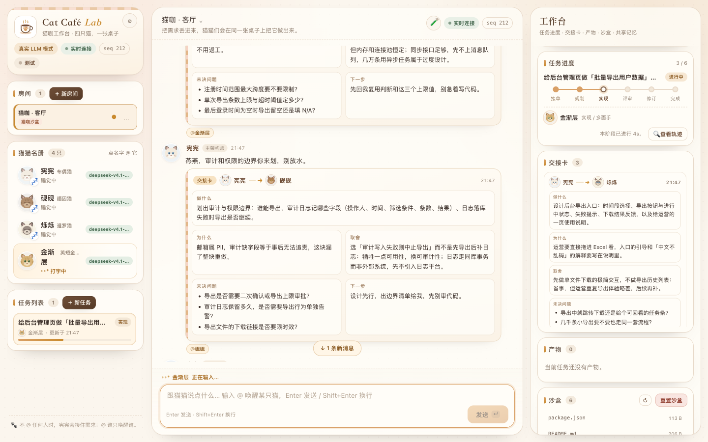
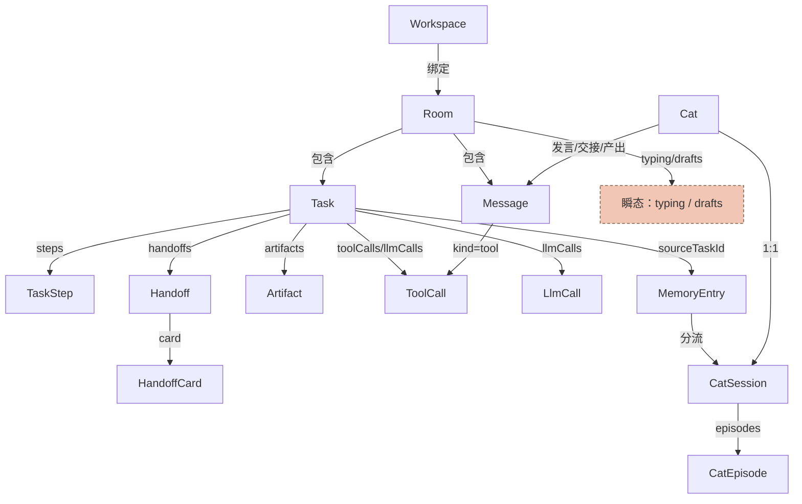

# 数据模型

交付台的所有领域类型定义在 `src/domain/types.ts`——**这是唯一契约**，其它模块只读。
本文解释这些结构之间的关系、各字段的含义，以及**哪些会写进磁盘、哪些只是运行时状态**。



---

## 1. 总览：`StudioState`

整个应用只有一个状态容器 `Studio`，它的快照就是 `StudioState`：

```ts
interface StudioState {
  rooms: Room[];
  cats: Cat[];           // 在职成员（数量可配置）
  retiredCats: Cat[];    // 已移除成员，仅用于历史渲染
  messages: Message[];
  tasks: Task[];
  handoffs: Handoff[];
  artifacts: Artifact[];
  memory: MemoryEntry[];
  catSessions: Record<CatId, CatSession>;
  toolCalls: ToolCall[];
  llmCalls: LlmCall[];
  typing: Record<RoomId, CatId | null>;
  drafts: Record<RoomId, { catId: CatId; text: string; at: number } | null>;
  seq: number;       // 单调递增，SSE 去重
  mode: BrainMode;   // "mock" | "llm"
  startedAt: number;
}
```

| 字段 | 内容 | 容器 / 容量 |
|---|---|---|
| `rooms` | 房间；每个房间绑定一个工作区 | 至少 1 个 |
| `cats` | 四个成员的档案；来自代码默认值 + 存档覆盖 | 固定 4 只 |
| `messages` | 房间消息流（聊天、交接、评审、工具、产物、决策、系统） | 最多 1500 条（超出丢最旧） |
| `tasks` | 任务（阶段、owner、步骤、git 状态） | 无上限（随房间删除清理） |
| `handoffs` | 结构化交接卡 | 无上限 |
| `artifacts` | 产物（spec / design / patch / review / decision），带版本号 | 无上限 |
| `memory` | 共享记忆（decision / lesson / preference） | 无上限 |
| `catSessions` | 每个成员的跨任务经历 | 按成员 8 条 episode + 12 条 lesson |
| `retiredCats` | 已移除成员 | 只做历史渲染，不参与协作；引擎/名册/@ 路由只看 `cats` |
| `toolCalls` | 沙盒 / MCP 工具调用记录 | 最多 300 条 |
| `llmCalls` | 模型调用记录（可观测性） | 最多 200 条 |
| `typing` | 当前谁在打字 | 每房间 1 个 |
| `drafts` | 流式草稿（半透明气泡） | 每房间 1 个 |

### 关系图



> `Trigger` / `CatTurn` / `TurnContext` 不属于持久状态，它们是 brain 与 driver 之间的一轮交互契约，见 §8–§9。

---

## 2. 持久化边界（哪些会写盘）

### `data/studio.json`

`Studio.persistNow()` 会把**整个 `StudioState`** `JSON.stringify` 写入 `data/studio.json`：

- **写入方式**：200ms 防抖 → 写 `${file}.tmp` → `rename` 原子替换；
- 进程正常退出（`SIGINT` / `SIGTERM` / 测试 `close()`）会立即 flush；
- 服务被强杀时，最多丢最后一小段（< 200ms～1s）未落盘的改动。

**重启后恢复**：`rooms` / `cats`（覆盖字段）/ `messages` / `tasks` / `handoffs` / `artifacts` / `memory` /
`catSessions` / `toolCalls` / `llmCalls` / `seq` / `mode` / `startedAt`。

**重启后清空 / 重新计算**：

| 字段 | 处理 |
|---|---|
| `typing` | 加载时全部重置为 `null`（避免残留「永远在打字」） |
| `drafts` | 加载时清空为 `{}`（避免残留半截草稿气泡） |
| `cats` 覆盖 | 只接受白名单字段；非法值丢弃，`id` / `role` / `model` / `avatar` 不可覆盖 |
| `rooms[].workspaceId` | 缺省补成内置沙盒 `ws_sandbox` |

存档里 `cats` 的可覆盖字段（`sanitizeCatOverrides`）：`name` ≤8、`title` ≤24、`persona` ≤100、
`catchphrase` ≤50、`greeting` ≤100、`accent`（hex）、`llmModel` ≤80、`llmTemperature` 0–2、
`tools` ≤24 个、`skills` ≤12 个；名字重名时回退默认名。

### 其它持久化文件（都不在 `StudioState` 里）

| 文件 | 内容 | 备注 |
|---|---|---|
| `data/settings.json` | 运行模式、节奏、工具开关/审批策略、流式、engine、主动巡查、LLM baseUrl/model/temperature | **不含 API key / headers** |
| `data/workspaces.json` | 自定义工作区（名称、绝对路径、只读/读写、是否建任务分支） | 内置沙盒不落盘 |
| `data/mcp.json` | MCP server 配置 | 含命令 / URL / env / headers，权限 `0600`；值不回传前端 |
| `data/scenarios.json` | 导入的自定义剧本 | 内置剧本来自代码 |
| `data/workspace/` | 内置沙盒文件 | 由 `src/tools/seed.ts` 首次种下 |

### 只在内存里（重启即失效）

- **API Key**：只存在 `SettingsStore` 内存；重启后需重填或用 `LLM_API_KEY` 环境变量。
- **审批队列**：`ApprovalQueue` 的待审批项与「批准并记住」记录；重启后悬挂审批作废。
- **MCP 连接**：客户端连接、工具注册表里的动态工具。
- **SSE 客户端与 seq 去重状态**：属于前端。

---

## 3. 成员：`Cat` / `CatSession` / `CatEpisode`

### `Cat`

```ts
interface Cat {
  id: CatId;                 // xianxian / yanyan / shuoshuo / jinjianceng
  name: string;              // 林知远 / 沈砚 / 周烁 / 陈实
  species: string;           // 布偶成员 / 缅因成员 / 暹罗成员 / 英短陈实
  role: Role;                // architect / reviewer / designer / implementer
  title: string;             // 角色定位
  model: CatModel;           // claude / gpt / gemini / opencode（展示用）
  persona: string;
  catchphrase: string;
  accent: string;            // 主题色 hex
  avatar: "ragdoll" | "mainecoon" | "siamese" | "golden";
  greeting: string;
  llmModel?: string;         // 真实模式：覆盖全局模型
  llmTemperature?: number;   // 真实模式：覆盖全局温度
  tools?: string[];          // 允许的工具名；undefined = 全部；[] = 一个都不给
  skills?: string[];         // 技能包 id；undefined/[] = 角色默认
}
```

- `tools` 语义：`undefined` → 全部允许；数组（含空数组）→ 只允许列出的工具。
- `skills` 语义：`skillsForCat()` 优先用显式列表；空 / 缺省回落到角色默认
  （architect→`architecture`、reviewer→`review-checklist`、designer→`design-system`、implementer→`tdd`）。
- `role` 决定阶段流转里的默认职责；`id` / `name` 用于 @ 解析（名字优先，其次 id）。

### `CatSession` / `CatEpisode`

```ts
interface CatEpisode {
  taskId: TaskId;
  title: string;                                   // ≤80 字
  summary: string;                                 // ≤300 字
  outcome: "done" | "abandoned" | "open";
  at: number;
}

interface CatSession {
  catId: CatId;
  episodes: CatEpisode[];   // 最近 8 个任务，同一任务只留一条
  lessons: MemoryEntry[];   // 从共享记忆分流到这个成员的教训，最多 12 条
  updatedAt: number;
}
```

用途：真实模式下把「这个成员上次参与过什么、踩过什么坑」注入 `TurnContext.session`，避免每次任务都失忆。

---

## 4. 房间与消息

### `Room`

```ts
interface Room {
  id: RoomId;
  name: string;              // 1–30 字，全局唯一
  topic: string;             // 房间说明，≤120 字
  catIds: CatId[];           // 房间里有哪几个成员（默认四只）
  workspaceId?: string;      // 绑定的工作区；缺省用内置沙盒
  createdAt: number;
}
```

每个房间同一时间只跑一个任务；需要并行就开多个房间（每个房间绑定自己的工作区）。

### `Message`

```ts
type MessageKind =
  | "chat" | "handoff" | "review" | "decision" | "artifact" | "tool" | "system";

interface Message {
  id: MessageId;
  roomId: RoomId;
  author: AuthorId;          // 成员 id / "user" / "system"
  kind: MessageKind;
  text: string;
  mentions: CatId[];         // 被 @ 的成员；空数组 = 没点名
  taskId?: TaskId;
  handoffId?: HandoffId;     // kind = handoff 时指向交接卡
  artifactId?: ArtifactId;   // kind = artifact / review / decision 时指向产物
  toolCallId?: ToolCall["id"]; // kind = tool 时指向工具调用
  at: number;
}
```

| kind | 谁产生 | 说明 |
|---|---|---|
| `chat` | 成员 / 负责人 / driver | 普通发言；工具被关时的说明也是 chat |
| `handoff` | driver | 交接卡消息，绑定 `handoffId`；漏 @ 时 `mentions` 仍写接收方，但不唤醒 |
| `review` | driver | 评审结论，绑定 review 产物的 `artifactId` |
| `decision` | driver | 任务收尾决策，绑定 decision 产物 |
| `artifact` | driver | 交付产物说明，绑定 `artifactId` |
| `tool` | driver | 工具执行回执，绑定 `toolCallId` |
| `system` | driver / Studio | 系统提醒（房间忙、入场等），不路由给成员 |

---

## 5. 任务：`Task` / `TaskHealth` / `TaskStage` / `TaskStep` / `TaskGit`

```ts
type TaskStage = "intake" | "planning" | "working" | "reviewing" | "revising" | "done";
type TaskStatus = "active" | "done" | "stalled";

interface Task {
  id: TaskId;
  roomId: RoomId;
  title: string;             // 由 brief 截断生成
  brief: string;             // 原始需求（≤2000 字）
  scenarioId: string;        // 播放哪个剧本（内置或自定义）
  status: TaskStatus;
  stage: TaskStage;
  owner: CatId;              // 当前阶段负责人
  steps: TaskStep[];
  createdAt: number;
  updatedAt: number;
  doneAt?: number;
  git?: TaskGit;
  health?: TaskHealth;       // 模型降级汇总，只有真实模式降级过才存在
  scenarioFallback?: boolean; // 需求没命中剧本、退而用近似剧本演出
}
```

### `TaskHealth`

```ts
interface TaskHealth {
  degradedCount: number;         // 累计降级次数
  lastDegradeReason?: string;    // 最近一次原因（截断）
  lastDegradeStage?: TaskStage;  // 最近一次发生在哪个阶段
  warned: boolean;               // 是否已提醒过负责人（避免刷屏）
}
```

`scenarioFallback` 为 true 时，说明需求没有命中任何剧本、只是用近似剧本把演出跑完：
任务卡会显示「近似演出」，且**不写场景决策记忆**（只落一条 `fallback-scenario` 教训）。

模型调用失败时会**静默降级**回演出台词，任务照常完成但产出质量掉档。为了让负责人
不用翻轨迹就知道，降级会在 `finishLlmCall` 时累加到这里：

- 第一次降级额外落一条系统消息（「后续产出可能不可信」）；
- 之后只累加计数，不再刷屏；
- 前端在任务卡和任务搜索里显示 `⚠ 降级 N` 徽标，悬停看原因。

### 阶段

| stage | UI 文案 | 典型 owner | 怎么推进 |
|---|---|---|---|
| `intake` | 接单 | 林知远 | 交代完需求 → 自动进 planning |
| `planning` | 规划 | 林知远 | 发出交接卡 → 接收方进 working |
| `working` | 实现 | 周烁 / 陈实 | 所有 worker 完成后进 reviewing |
| `reviewing` | 评审 | 沈砚 | `request_changes` → revising；`approve` → done |
| `revising` | 修订 | 陈实 | 交 v2 后重新进 reviewing |
| `done` | 完成 | 林知远 | 落 decision + memory，任务结束 |

- 修订最多 **3 轮**（`MAX_REVISION_ROUNDS`，引擎常量，不在状态里）；仍不通过会**强制收尾**，
  写一条 `manual-close` 教训到共享记忆。
- `status = "stalled"` 表示卡住等待负责人处理（漏 @、工具审批、异常），不是阶段。

### `TaskStep`

```ts
interface TaskStep {
  id: StepId;
  stage: TaskStage;
  owner: CatId;
  status: "pending" | "active" | "done";
  startedAt?: number;
  doneAt?: number;
}
```

每次进入阶段/换 owner 记一步，任务轨迹用它渲染阶段段落。

### `TaskGit`（仅绑定读写 git 工作区）

```ts
interface TaskGit {
  branch?: string;       // catcafe/<taskId>
  baseBranch?: string;
  baseCommit?: string;
  commit?: string;       // 人工确认提交后的 commit
  committedAt?: number;
  stashedAt?: number;    // 回滚时间（改动在 stash 里可恢复）
  error?: string;        // 建分支失败等提示
}
```

---

## 6. 交接、产物与记忆

### `Handoff` / `HandoffCard`

```ts
interface HandoffCard {
  what: string;
  why: string;
  tradeoff: string;
  openQuestions: string[];
  nextAction: string;
}

interface Handoff {
  id: HandoffId;         // ho_xxx
  taskId: TaskId;
  from: CatId;
  to: CatId;
  card: HandoffCard;
  createdAt: number;
}
```

- 五栏缺一栏，前端标黄；真实模式下接收方会追问缺失项。
- `fault: "missed_mention"` 是 **`CatTurn` / `ScenarioBeat` 上的演示埋点**，落库后只体现在
  任务变成 `stalled`、以及 driver 不唤醒接收方——`Handoff` 本身没有 fault 字段。

### `Artifact`

```ts
type ArtifactKind = "spec" | "design" | "patch" | "review" | "decision";

interface Artifact {
  id: ArtifactId;
  taskId: TaskId;
  kind: ArtifactKind;
  title: string;
  body: string;          // 纯文本 / 轻量 markdown
  author: CatId;
  version: number;       // 同一任务、同一 kind 自增（1,2,3…）
  createdAt: number;
}
```

- 版本号由 `Studio.addArtifact` 按「同任务同 kind 的数量 + 1」自动生成；
  所以 remember_me 会看到 patch v1 / v2、review v1 / v2。
- `review` 的正文由 `formatReviewBody()` 生成固定格式，前端按行解析 `[blocker]` / `[minor]`。

### `ReviewFinding` / `ReviewVerdict`

```ts
type Severity = "blocker" | "minor";
type ReviewVerdict = "approve" | "request_changes";

interface ReviewFinding {
  severity: Severity;
  title: string;
  detail: string;
}
```

### `MemoryEntry`

```ts
type MemoryKind = "decision" | "lesson" | "preference";

interface MemoryEntry {
  id: MemoryId;
  kind: MemoryKind;
  title: string;
  body: string;
  tags: string[];        // 去重后保存
  sourceTaskId?: TaskId;
  createdAt: number;
}
```

- 任务结束时林知远写 `decision`；评审里发现的问题沉淀为 `lesson`；`preference` 留给用户偏好。
- 记忆按「同 tag / 同任务」排序后注入下一轮的 `TurnContext.memory`（最多 12 条），
  所以第二个相关任务能引用上一次的决策。

---

## 7. 工具调用与模型调用

### `ToolCall`

```ts
type ToolCallStatus = "pending" | "running" | "ok" | "error" | "rejected";

interface ToolCall {
  id: string;
  taskId?: TaskId;
  catId: CatId;
  tool: ToolName;                // 内置四工具或 MCP 动态工具名
  input: Record<string, unknown>;
  label: string;                 // 人话摘要
  status: ToolCallStatus;
  exitCode?: number;             // run_command 的退出码
  output?: string;               // 截断后的 stdout+stderr（≤4000 字）
  startedAt: number;
  finishedAt?: number;
  approvalRequestedAt?: number;  // 进入 pending 的时间
  approvalDecidedAt?: number;    // 负责人做决定的时间
}
```

状态流转：`pending`（等审批）→ `running` → `ok` / `error`；被拒绝直接 `rejected`。
前端工具卡据此显示 ⏳ / 转圈 / ✓ / ✗，并显示真实退出码。

### `LlmCall`

```ts
interface LlmCall {
  id: string;
  taskId?: TaskId;
  catId: CatId;
  stage?: TaskStage;             // 在哪个阶段被唤醒
  trigger?: TriggerKind;         // 因为什么被唤醒
  model: string;
  engine: "api" | "cli";
  startedAt: number;
  finishedAt?: number;
  durationMs?: number;
  inputTokens?: number;
  outputTokens?: number;
  streamed?: boolean;
  degraded?: boolean;            // 失败降级到 mock
  degradeReason?: string;
  retried?: boolean;             // max_tokens 截断后重试
  turnKinds?: string[];          // 本轮产出了哪些 turn kind
  error?: string;
}
```

任务轨迹的汇总（耗时、token、降级、重试）都来自这里。模型调用记录只保留最近 200 条。

---

## 8. `CatTurn`：一轮里成员能产出的 8 种动作

`CatBrain.think(ctx)` 返回 `CatTurn[]`，driver 依次落库。一个 turn 一个动作：

| kind | 关键字段 | 落库效果 |
|---|---|---|
| `message` | `text`, `mentions?`, `delayMs?` | 写一条 `chat` 消息 |
| `silence` | `reason?` | 不写消息（主动巡查专用：成员判断「这里不需要我」） |
| `tool` | `tool`, `input`, `label?`, `text?` | 执行工具 → `ToolCall` + `tool` 消息；`input` 结构由工具 schema 校验 |
| `handoff` | `to`, `card`, `text?`, `fault?` | 写 `Handoff` + `handoff` 消息；`fault:"missed_mention"` 时任务 `stalled` 且不唤醒接收方 |
| `artifact` | `artifact:{kind,title,body}`, `text?`, `mentions?` | 写 `Artifact`（版本自增）+ `artifact` 消息 |
| `review` | `verdict`, `title`, `findings`, `text`, `mentions?` | 写 review 产物 + `review` 消息；`request_changes` 触发修订，`approve` 进 done |
| `decision` | `artifact:{title,body}`, `text`, `memory[]` | 写 decision 产物 + `decision` 消息，并批量写入共享记忆 |
| `memory` | `memory:{kind,title,body,tags}`, `text` | 写一条 `MemoryEntry` + 一条消息（decision / chat） |

补充：

- 所有 turn 都可带 `delayMs` 控制演出节奏；`mentions` 只影响消息展示与 @ 路由。
- `tool` 的 `tool` 名必须是 `ToolName`：内置 `read_file` / `write_file` / `list_files` / `run_command`，
  或 MCP 注册的动态名（形如 `<serverId>__<toolName>`）。
- mock brain 按 `(stage, cat)` 从剧本 beats 取 turn；真实模式由模型输出 JSON，再由结构校验过滤。

---

## 9. `Trigger`：本轮为什么被唤醒（8 种）

```ts
type TriggerKind =
  | "user_message" | "task_created" | "handoff" | "artifact"
  | "review_result" | "tool_result" | "nudge" | "proactive";

interface Trigger {
  kind: TriggerKind;
  roomId: RoomId;
  taskId?: TaskId;
  text?: string;
  mentions?: CatId[];
  fromCatId?: CatId;
  handoff?: HandoffCard;
  artifact?: Artifact;
  review?: { verdict: ReviewVerdict; findings: ReviewFinding[] };
  toolResults?: ToolRunResult[];
}
```

| kind | 什么时候产生 | 唤醒谁 |
|---|---|---|
| `user_message` | 负责人发言 | 被 @ 的成员；没 @ 时任务 owner / 林知远 |
| `task_created` | 创建任务 / 从 intake 自动进 planning | 林知远（kickoff / planning） |
| `handoff` | 交接卡投递给接收方 | 设计 / 实现（worker）或沈砚（reviewer） |
| `artifact` | 产物落库后请求评审 | 沈砚 |
| `review_result` | 评审结论回来 | `request_changes` → 实现者修订；`approve` → 林知远收尾 |
| `tool_result` | 工具执行完回喂模型（ReAct） | 同一个成员继续推理 |
| `nudge` | 负责人点「催一下」 | 林知远做恢复 / 补投递 |
| `proactive` | 主动巡查模式到点 | 巡查选中的成员（可能返回 `silence`） |

---

## 10. 场景：`Scenario` / `ScenarioBeat`

```ts
interface ScenarioBeat {
  stage: TaskStage;
  cat: CatId;
  turn: CatTurn;
  fault?: "missed_mention" | "silent_drop";
}

interface Scenario {
  id: string;            // remember_me / export_csv / 自定义
  name: string;
  sampleBrief: string;   // UI 一键填入的示例需求
  tags: string[];        // 自动匹配剧本的关键词
  beats: ScenarioBeat[];
}
```

- 内置剧本来自 `src/agents/scenarios.ts`；导入的自定义剧本追加到同一数组（`scenario-registry.ts`）。
- mock brain 按 `(stage, cat)` 取 beat；同阶段连续的工具/交接节拍可以一次交付。
- `fault` 是**演示埋点**，由 mock brain 透传到 `turn.handoff.fault`，driver 只认 turn 上的字段。
- 自定义剧本导入时由 `scenario-validation.ts` 校验：id 格式、成员 id 存在、五栏完整、turn kind 白名单、
  文本长度、`beats ≤ 120` 等。

---

## 11. 工作区：`Workspace` / `WorkspaceGitInfo`

```ts
type WorkspacePolicy = "read-only" | "read-write";

interface Workspace {
  id: string;                 // ws_xxx；内置沙盒固定 ws_sandbox
  name: string;
  root: string;               // 绝对路径
  policy: WorkspacePolicy;
  kind: "sandbox" | "repo";
  isGit: boolean;
  branchPerTask: boolean;     // 任务开始建 catcafe/<taskId> 分支（仅读写 git 仓库生效）
  createdAt: number;
}

interface WorkspaceGitInfo {
  workspaceId: string;
  isGit: boolean;
  branch?: string;
  clean?: boolean;
  status?: string;            // git status --porcelain
  diffStat?: string;
  lastCommit?: string;
  error?: string;
}
```

- 只读工作区由 `PolicySandbox` 拦下 `write_file` / `run_command`，返回 error 回执。
- 真实仓库默认只读；切读写必须显式 `confirm`。
- 内置沙盒（`data/workspace`）不写入 `workspaces.json`。

---

## 12. 工具目录、技能与 MCP 配置

### `ToolDefinition` / `ToolRegistry` / `ToolResult`

```ts
interface ToolDefinition {
  name: ToolName;
  title: string;
  description: string;
  inputSchema: Record<string, unknown>;   // JSON Schema 风格
  risk: "safe" | "needs_approval";
  source: "sandbox" | "mcp";
  serverId?: string;                      // MCP 工具才有
}

interface ToolRegistry {
  list(): ToolDefinition[];
  get(name: ToolName): ToolDefinition | undefined;
  execute(name: ToolName, input: Record<string, unknown>): Promise<ToolResult>;
}

interface ToolResult {
  status: "ok" | "error" | "rejected";
  exitCode?: number;
  output: string;
}
```

内置工具：`read_file` / `write_file` / `list_files`（safe）、`run_command`（needs_approval）。
MCP 工具默认 `needs_approval`，可在配置里改成 `safe`。

### `Skill`

```ts
interface Skill {
  id: string;
  name: string;
  description: string;
  prompt: string;   // 注入真实模式 system prompt 的方法论
}
```

### `McpServerConfig` / `McpStatus`

```ts
interface McpServerConfig {
  id: string;
  name: string;
  transport: "stdio" | "http";
  command?: string;                 // stdio
  args?: string[];                  // stdio
  url?: string;                     // http
  enabled: boolean;
  risk?: "safe" | "needs_approval";
  env?: Record<string, string>;     // stdio 子进程环境变量（值不落盘到状态）
  headers?: Record<string, string>; // http 鉴权头（值不落盘到状态）
}

interface McpStatus {               // 前端只能看到这份
  id: string;
  name: string;
  transport: "stdio" | "http";
  enabled: boolean;
  status: "connecting" | "connected" | "error" | "disconnected";
  toolCount: number;
  lastError?: string;
  command?: string;
  args?: string[];
  url?: string;
  risk: "safe" | "needs_approval";
  envKeys: string[];                // 只有键名
  headerKeys: string[];             // 只有键名
}
```

MCP 配置持久化在 `data/mcp.json`（`0600`），`env` / `headers` 的值不会进 `StudioState`、不会进 SSE。

---

## 13. 运行时设置

`PublicSettings` / `SettingsPatch` 定义在 `types.ts`，由 `SettingsStore` 读写。

- 可持久化到 `data/settings.json` 的字段：`mode`、`speed`、`toolsEnabled`、`toolApproval`、
  `streaming`、`engine`、`proactive`、`proactiveIntervalMs`、`llm.{baseUrl,model,temperature}`。
- **设置里的 LLM API Key / `LLM_HEADERS` 永不落盘**；`PublicSettings.llm` 只暴露 `hasKey` 与 `keySource`。
  （MCP 的 `env` / `headers` 是例外：它们要持久化在 `data/mcp.json`，但同样不回传前端、不进状态。）
- 启动顺序：存档值 → 环境变量默认值 → 兜底默认（`normal` / `commands` / `streaming: true` / `api`）。
- 如果存档里是 `mode: "llm"` 但配置不完整（没有 baseUrl/model/key），会回落到演出模式。

---

## 14. 数字与上限速查

| 项 | 值 |
|---|---|
| 消息（`messages`） | 最多 1500 条（超出丢最旧） |
| 工具调用（`toolCalls`） | 最多 300 条 |
| 模型调用（`llmCalls`） | 最多 200 条 |
| 按成员 episodes / lessons | 8 / 12 |
| 任务修订上限 | 3 轮（引擎常量，非状态字段） |
| 请求体 / 文本上限 | 64 KB / 2000 字符 |
| 消息流注入 brain | 最近 24 条 |
| 记忆注入 brain | 最多 12 条 |
| 沙盒命令超时 / 输出截断 | 10s / 4000 字 |
| 审批等待超时 | 5 分钟自动拒绝（内存队列） |
| 状态写盘防抖 | 200ms，临时文件 + rename |
| SSE 心跳 / 重连建议 | 15s / 3s |
