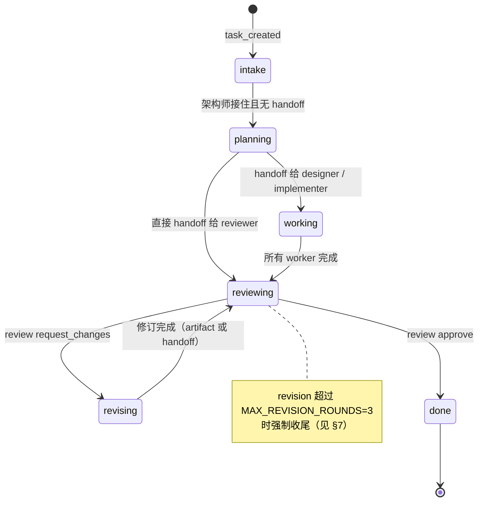

# 协作引擎（driver.ts）

> 一句话：driver 是「什么时候让哪个成员想什么」的调度器。
> 台词和决策来自 brain，状态落库来自 Studio；driver 只负责**队列、路由、阶段推进、故障恢复**。
>
> 源码：`src/engine/driver.ts`（约 1.8k 行）、`src/engine/stages.ts`（纯状态机）、`src/engine/mentions.ts`（@ 路由）。
> 测试：`tests/engine.test.ts`（状态机/审批/回喂）、`tests/proactive.test.ts`（巡查）、`tests/task-actions.test.ts`（三选一恢复）。

---

## 0. 全貌

```
submit(event)                    外部事件（HTTP → driver）
   │
   ▼
roomId 串行队列 ──► processWake(wake)
                       │  1. setTyping / startLlmCall / onDelta → drafts
                       │  2. brain.think(TurnContext) ──► CatTurn[]
                       │  3. applyTurns：message / handoff / tool / artifact / review / decision / memory
                       │  4. ReAct：有工具回执就带着 tool_result 再问同一个成员（有上限）
                       │  5. afterTurns：按阶段机推进 / 路由下一个 wake / stall 计时
                       ▼
                    Studio mutator ──► seq++ ──► SSE 全量快照
```

一个 wake = 「让某个成员想一轮」。driver 本身不产生剧情文本，唯一的例外是工具被关闭 /
未接沙盒 / 权限不足 / 审批等待这类**机制性提示**。

---

## 1. 事件驱动模型

### 入口事件

`EngineEvent` 只有 4 种（`src/domain/types.ts`）：

| 事件 | 何时产生 | 要点 |
|---|---|---|
| `task_created` | `POST /api/tasks` | 建任务后启动 kickoff，owner 是架构师 |
| `user_message` | `POST /api/rooms/:id/messages` | `mentions` 决定唤醒谁；`force` 用于跳过「房间忙」提醒 |
| `nudge` | `POST /api/tasks/:id/nudge`、UI「催一下」 | 让架构师做恢复 |
| `task_action` | `POST /api/tasks/:id/action` | `continue / pivot / close` 三选一（见 §7） |

`submit()` 是**同步入队、立即返回**。真正的执行在房间队列里。

### 房间串行队列

```ts
const queues = new Map<RoomId, Promise<void>>(); // 每房间一条 promise 链
let pending = 0;                                // 全局未完成任务数（whenIdle 用）
const roomPending = new Map<RoomId, number>();  // 每房间未完成 wake 数（stall 判定用）
```

- **按 roomId 串行，不按全局串行**：同一个房间共享 timeline / 当前任务 / typing / 队列，
  交接必须严格有序（planning → worker → reviewer 的因果不能乱）；不同房间互不阻塞。
- **内部 wake 也进同一队列**（`enqueueWake`），所以一次 kickoff 会衍生 planning → worker →
  reviewer → decision 一整条链，全部按顺序执行。
- `whenIdle()`：全局 `pending === 0` 时 resolve。测试和「等这一波跑完」的接口用它；
  不区分房间。

**已知限制**：内部 wake 排在队列尾部，外部用户消息如果正好在链中间提交，会插在两个阶段之间。
状态机对此是安全的（每次 wake 都重新读 task/stage），但「task_created 到卡住前完全原子」并不成立。

### processWake 的一轮

1. `clearStall`，`studio.setTyping(roomId, catId)`；
2. 每轮 think 前后包一条 `LlmCall`：`startLlmCall` → `buildContext` → `brain.think` →
   `finishLlmCall`（合并 `BrainReport`：模型、token、降级、重试、turnKinds）；
3. `onDelta` 增量只接受本房间的草稿：`studio.setDraft(roomId, {catId, text})`；无论成败
   `finally` 都清空草稿；
4. 巡查轮先过滤掉非 `message / silence / tool` 的 turn（见 §8）；
5. `applyTurns()` 落库，`mergeApplied()` 合并回喂轮产出；
6. `afterTurns()` 做阶段推进和下一个 wake 的路由；
7. `finally`：清 typing；任务仍是 `active` 就重新 `scheduleStall`。

`task.status === "done"` 的任务不会再处理（`chat` 例外，允许收尾后继续闲聊）。

---

## 2. Wake 的 8 种 purpose

`WakePurpose` 定义在 driver.ts。它回答「这一轮为什么叫成员」，决定 `afterTurns` 怎么收尾。

| purpose | 谁产生 | trigger.kind | 期望动作 | afterTurns 做什么 |
|---|---|---|---|---|
| `kickoff` | `submit(task_created)` | `task_created` | 架构师接住需求 | 结束 intake step；没发 handoff 就自动进 planning 并排 planning wake |
| `planning` | kickoff 自动续排 | `task_created` | 拆活 + 发五栏交接卡 | 只路由 handoff；没交接就停在 planning 等 stall |
| `chat` | `submit(user_message)` | `user_message` | 被 @ / owner 接话 | 不推进阶段（但 turn 里的 handoff 仍会正常路由） |
| `nudge` | `submit(nudge)`、`task_action continue/pivot` | `nudge` | 架构师解释/恢复 | 解除 stalled；有漏 @ 的交接就补投递 |
| `patrol` | `patrolOnce()`（定时或手动） | `proactive` | 非 owner 成员判断要不要插话 | 什么都不推进（turn 已在执行前过滤） |
| `worker` | handoff 给非 reviewer / review 打回 / 补投递 | `handoff` / `review_result` | 产出 artifact/patch | worker 计数 -1；归零后进 reviewing |
| `reviewer` | 所有 worker 跑完 / 直接 handoff 给 reviewer | `artifact` / `handoff` | review 一次，只给一个 verdict | 按 verdict 进 revising 或 done |
| `decision` | review approve | `review_result` | 架构师落 decision + memory | 结束任务、记 episode |

### 8 种 TriggerKind 与唤醒场景

| kind | 喂给谁 | 场景 |
|---|---|---|
| `task_created` | 架构师 | kickoff / planning |
| `user_message` | 被 @ 的成员 / 任务 owner / 架构师 | 用户说话 |
| `handoff` | 交接接收方、reviewer | 阶段推进 |
| `artifact` | reviewer | 工作做完但没显式交接卡时的兜底 |
| `review_result` | 被 @ 的实现者 / 架构师 | 打回修订 / approve 后落 decision |
| `tool_result` | 同一个成员 | ReAct 回喂（§4） |
| `nudge` | 架构师 | 卡住恢复、换方案 |
| `proactive` | 被巡查选中的成员 | 主动协作（§8） |

---

## 3. 阶段状态机

纯函数在 `src/engine/stages.ts`，driver 负责把决策落成 Studio mutator。



| 阶段 | owner | 进入条件 | 离开条件 | 产出 |
|---|---|---|---|---|
| `intake` | 架构师 | task_created | kickoff 轮结束（有 handoff 则直接跳转） | 接住需求的 message |
| `planning` | 架构师 | intake 无 handoff | handoff 目标角色 | 消息 + 五栏交接卡 |
| `working` | designer / implementer | handoff 给非 reviewer | 所有 worker 计数归零 | artifact（design / patch） |
| `reviewing` | reviewer | 显式交接给 reviewer，或 worker 全部完成 | verdict | review artifact |
| `revising` | implementer（或 @ 到的作者） | request_changes | 修订轮结束 | v2 patch |

> 上图标的是正常主流程；如果 intake / planning 轮直接给出 handoff，driver 也会按
> `handoffMove` 直接跳到对应阶段（没有「必须先经过 planning」的硬约束）。
| `done` | 架构师 | approve 后的 decision 轮结束 | — | decision artifact + memory |

### 推进规则（`handoffMove` / `reviewMove`）

- 交接给 **reviewer** → `reviewing`；
- 在 `reviewing` / `revising` 里交接给其他成员 → `revising`（打回返工）；
- 其他交接 → `working`；
- `request_changes` 回给谁：优先被 @ 的 implementer，其次 @ 到的 designer/implementer，
  再次最近一个 patch 的作者，最后按角色兜底（`pickReviseTarget`）；
- `approve` → `done`，owner 是架构师，等它产 decision。

### 关键细节

- **`beginStage` 是幂等的**：stage 相同直接返回；如果任务已被删除（重置/删房间后队列里
  还残留旧 wake），也会安静跳过，避免一个已删除任务打断整条队列。
- **多 worker 的延期投递**：`planning` 一次给周烁和陈实各一张卡时，driver 先记下
  `runtime.deferredReviewer`；等 `runtime.workers` 归零才真正进入 reviewing。
  否则先跑完的成员会把阶段推到 reviewing，另一个成员就会在错误的阶段说话。
- **漏 @ 绝不自动绕过**：`handoff.fault === "missed_mention"` 时，卡片和消息照写
  （`mentions` 仍写接收者，表示「本意是给它的」），但 driver 不唤醒接收方、把任务标
  `stalled`，并记下 `runtime.missed`。只有 `nudge` 会补投递并恢复。**所有 worker 完成时
  也不会自动进 reviewing** —— 否则「卡住 → 催一下」这一幕就不存在了。
- **一次 think 只认第一个 review turn**：模型偶尔一轮返回两个 verdict，按顺序执行会
  「打回 + 通过」互相覆盖、直接跳过 revise。第二个会被丢弃并 `console.warn`。
- **tool turn 永远不推进阶段**：工具轮只记 ToolCall / 消息 / 回执，阶段推进统一在
  `afterTurns` 里做。

---

## 4. ReAct 回喂循环

真实模式下，模型可能先要读文件、跑测试，再根据结果继续。流程在 `processWake` 的
`for (;;)` 里：

```
think(trigger)
  └─ applyTurns(turns) ──► 本轮 toolResults
       ├─ 没有工具结果            → 结束
       ├─ 工具连续失败达到上限     → 结束（让模型基于已有信息收尾）
       ├─ 回喂轮数达到 roundCap   → 结束
       └─ 否则 trigger = {kind:"tool_result", toolResults} → 再 think
```

| 常量 | 值 | 解决什么问题 |
|---|---|---|
| `MAX_TOOL_ROUNDS` | 3 | 一般阶段的回喂上限：首轮 + 最多 3 次回喂 |
| `MAX_EXPLORE_ROUNDS` | 1 | intake / planning 只给 1 次回喂。真实推理模型容易在接单阶段连续 `list_files` 探索，把回喂轮数用光后因 max_tokens 截断降级，任务卡在 intake |
| `MAX_CONSECUTIVE_TOOL_FAILURES` | 3 | 沙盒限制导致模型反复换写法重试（实测一条任务 40 次工具调用、10 次审批）；连续失败到阈值就停，省 token |
| `RECENT_TOOL_RESULTS` | 8 | `TurnContext.recentToolResults` 只带最近 8 条**已结束**回执（ok/error/rejected；pending/running 不算） |

失败计数规则（`updateFailureStreak`）：本轮只要有一个 `ok` 就清零；否则累加本轮失败数。
回喂轮本身**不推进阶段**；回喂轮里产生的 handoff / review / decision 会和首轮一起在
循环结束后交给 `afterTurns` 统一处理。

**已知限制**：只有 `brain.mode === "llm"` 才回喂；mock 剧本永远只 think 一次。

---

## 5. 工具执行与审批

### 执行顺序（`runToolTurn`）

```
toolsEnabled? 否 → 说明消息，结束
  │ 是
选 runner：MCP → registry
           内置 → 房间绑定的工作区沙盒（sandboxFor(roomId)）
           否则 → 全局 executor（tools ?? sandbox）
  │ 没有 runner → 「没接沙盒」说明消息，结束
cat.tools 权限检查 → 未授权：记 error ToolCall + 回执，不执行
  │ 有权限
审批判定 → pending → request → 拒绝：记 rejected，不执行
                             → 批准：startToolCall 再执行
  │ 不需要审批 / 批准后
执行 → finishToolCall → kind:"tool" 消息（带 toolCallId）→ ToolRunResult
```

### 审批规则

- **只对模型驱动生效**：`brain.mode === "llm"` 且注入了 `ApprovalGate`；mock 剧本永远自动放行。
- 策略（`approvalFor`）：
  - `auto`：不审批；
  - `commands`：风险优先看注册表 `ToolDefinition.risk`，`needs_approval` 的工具都要批
    （MCP 工具也算）；没有注册表时按 `run_command` 需审批兜底；
  - `all`：所有工具都批。
- `ToolCall.status` 的生命周期：`pending → running → ok / error / rejected`。
- `remember`：审批通过时传 `remember: true`，同一个成员 + 同一工具后续自动放行/拒绝
  （`POST /api/tool-calls/:id/approve|reject` body `{remember?: true}`）。
- **5 分钟超时自动拒绝**（`ApprovalQueue`），避免任务永远挂起；审批请求抛异常也按拒绝处理。
- **审批期间不会误判卡住**：wake 还没结束，stall timer 没排；等人不算成员卡住。

### 并行工具（`isParallelizableTool`）

只有 `read_file` / `list_files` 可以并行：模型一轮发 4–6 个读请求很常见，串行要等很多次 IO。
实现是「连续的同类型可并行工具」凑成一批 `Promise.all`，遇到写/命令/其他 turn 就断开。

`write_file` 会改变后续读的结果，`run_command` 有副作用，审批还可能挂 5 分钟——**必须串行**，
否则因果顺序和审批队列都会乱。

### 工具目录与提示

- label 缺省：内置工具用专有措辞（`写入 path` / `运行 cmd args`）；非内置工具用
  `ToolDefinition.title · JSON(input) 截断 60 字`。
- 结果文案缺省：内置工具按工具生成；非内置工具 `${title} 完成 / 失败`。
- 工具被关掉 / 没有 runner 时只发一条 chat 说明，协作流程继续。
- 按成员权限（`cat.tools`）：`undefined` = 全部，数组 = 白名单（空数组 = 什么都没有）。
  未授权工具不执行、不弹审批，直接记 `error` 回执喂回模型。

---

## 6. stall 判定（两次误报的修复）

`scheduleStall(taskId)` 在每轮 wake 结束时排一个 `stallMs`（默认 12s）的定时器；
下一次 wake 开始 / nudge / 任务动作时 `clearStall`。定时器触发时：

1. 任务已不是 active → 忽略；
2. **房间队列还有 wake 在跑或排队**（`roomPending > 0`）→ 重新计时；
3. **有未完成的 LLM 调用**（`llmCalls` 里同任务 `finishedAt` 为空）→ 重新计时；
4. 否则才 `setTaskStatus("stalled")`。

### 修复史

| 现象 | 原来错在哪 | 修复 |
|---|---|---|
| 同房间两个任务排队时，后一个任务显示「卡住了」 | 只看「距上次动作超过 stallMs」，把**排队等待**当成卡住 | 加 `roomPending` 计数：房间还有 wake 没跑完就重新计时（commit `3360448`） |
| 真实模型单轮推理 20–60s，被误判「卡住了」，用户跑去干预正常流程 | `stallMs` 默认 12s，远小于推理耗时；只看 `task.updatedAt` | 检查是否有未完成 `llmCall`，有就继续等（commit `fefa5d1`，UAT P1） |

**已知限制**：stall timer 不持久化，进程重启后不会自动重排；任务状态本身持久化，
需要 UI 再催一下或来一条事件才会恢复计时。

### 6.1 评审只说话不给结论：自动补一轮

真实模型在 reviewing 阶段常见行为：跑了几轮工具、只发言，**始终不给 `review` 结论**，
阶段不推进 → 12s 后被 stall 判定抓住，看起来像「卡住了」。

现在 `afterTurns` 的 reviewer 分支在 `applied.review` 为空时：

1. 若本轮还没补过（`runtime.reviewConclusionForced !== true`）→ 置位并投递一轮
   `purpose: "reviewer"` 的 wake，trigger 里明确要求
   「必须输出 `kind:"review"`，verdict 为 approve / request_changes」；
2. 补过仍没有结论 → 保持原行为（stall + 恢复面板三选一）。

### 6.2 暂停中的任务只接 chat / nudge

模型失败会把任务置 `stalled`。队列里可能还压着早期排进来的 kickoff/worker wake，
放它们继续跑只会**再失败一次、再刷一条「模型调用失败」**。

`processWake` 开头因此加了守卫：`task.status === "stalled"` 时只允许
`purpose` 为 `chat` / `nudge` 的 wake 继续，其余直接丢弃；
恢复面板的「继续试试」会先把状态改回 `active` 再入队。

---

## 7. 修订上限与任务收尾

`MAX_REVISION_ROUNDS = 3`，计数在 `TaskRuntime.revisions`。真实模型下 reviewer 可能
持续要求修改（实测打回 4 次以上，任务永远在 reviewing ↔ revising 打转）。

超过上限时 driver：

1. 写一条 `lesson`（`tags: ["review-loop", "process"]`）；
2. 用 `studio.deliverySummary(taskId)` 生成交付摘要——已有产物、最近一次 review 的
   blocker、verdict；
3. 发一条 system 消息：拿到了什么、还差什么、下一步可以点「继续试试 / 换个方案」；
4. 直接 stage/status 置 `done`，清掉 stall。

### 任务三选一（`task_action`）

| action | 行为 |
|---|---|
| `continue` | 解除 stalled，唤醒架构师继续（等价 nudge） |
| `pivot` | 解除 stalled，以用户口吻插入「换个方案」消息，再让架构师重新拆活 |
| `close` | `studio.closeTaskWithReason`：system 消息 + `manual-close` 教训 + 任务 done |

**可复活规则**：正常完成的任务不能重开；只有被强制收尾（记忆里有 `review-loop` tag）的
任务，`continue / pivot` 才会把它重新置为 active。

**已知限制**：`recordTaskEpisodes` 只在正常 decision 路径调用；手动 close / 强制收尾不会
写 episode（会话里看不到这段经历）。

---

## 8. 主动巡查

目标：让没被 @ 的成员也有机会说话，但**不能变成噪音或抢 owner 的活**。

| 机制 | 实现 |
|---|---|
| 启停 | `setProactive(enabled, intervalMs)`；`setInterval` + `unref`，设置面板切换即时生效 |
| 手动触发 | `POST /api/patrol` → `driver.patrol()` |
| 选房间 | 只巡查有 `active` 任务的房间 |
| 选成员 | `pickPatrolCat`：排除当前 owner；超过 `proactiveIntervalMs` 没巡查过；reviewer 优先，其次 architect，再其他 |
| 一轮只一只 | 每个任务每轮只排一个巡查 wake；`patrolling` 防重入 |
| 巡查轮权限 | 在执行前过滤：只保留 `message / silence / tool`；handoff / review / decision / artifact 一律丢弃 |
| 出口 | 成员可以返回 `silence` turn（什么都不说）；不会产生消息，但会记在 `LlmCall.turnKinds` 里可审计 |

### 为什么巡查不能阻塞接口

`patrol()` 只负责**把巡查 wake 排进房间队列**，然后立刻返回；执行完成与否用 `whenIdle()`
或 SSE 观察。

**修复史**：最初 `POST /api/patrol` 会等待巡查执行完。房间队列里如果正跑着一个真实模型
任务（单轮几十秒），这个 HTTP 请求就会长时间不返回，前端以为服务卡死（commit `88e5757`）。
改成「排队即返回」后，接口耗时与房间忙闲无关。

**已知限制**：队列繁忙时巡查会排到任务后面；`setInterval` 触发时如果前一次还没跑完，
`patrolling` 会直接跳过（不会被堆积）。

---

## 9. 房间忙保护（方案 A）

一个房间同时只做一件事。用户在有活跃任务的房间里说话时：

- `activeTaskIn(roomId)` 找 status ≠ done 的最近任务；
- 没有 `force` 时，先插一条 **system 提醒**：当前任务在哪个阶段、新需求会被当成补充、
  建议新建房间或等结束；
- **消息照常路由**（被 @ 的成员 / owner 继续接话），不是拒绝、也不是悄悄丢弃。

### 为什么选方案 A

| 方案 | 问题 |
|---|---|
| 直接拒绝 | 用户的话没了，体验差 |
| 静默排队 / 自建新任务 | 用户不知道发生了什么，两条需求的内容会混在一起 |
| **提示后放行（A）** | 明确告知风险，同时保留「我就是要说」的出口；`force: true` 跳过提醒 |

HTTP `POST /api/rooms/:id/messages` 透传 `force`；前端在输入框上方常驻提示条，
点「就是补充给它」后带 `force` 发送（commit `47c13ef`）。

**已知限制**：提醒本身是一条 system 消息，会进 timeline；`force` 需要调用方显式传。

---

## 10. 按成员会话与可观测性

### LlmCall / trace

每次 `brain.think` 包一条 `LlmCall` 记录（`studio.startLlmCall` → think →
`studio.finishLlmCall`）：模型、阶段、trigger、耗时、token、流式、降级、重试、
产出的 turn 类型。`GET /api/tasks/:id/trace`
把消息 / 交接 / 产物 / 工具 / LLM / 记忆拼成任务时间线。这是协作层唯一能看清
「钱和时间花在哪」的地方。

### 流式草稿

`TurnContext.onDelta` 把已累计的草稿文本推给 driver；driver 只接受本房间的更新
（防串台），落 `state.drafts[roomId]`（瞬态，不持久化）。一轮结束 `finally` 清空，
正式消息接管。

### 按成员会话（`CatSession`）

任务正常完成时 `recordTaskEpisodes` 会给**参与过该任务的每个成员**记一条 episode：

- 参与判定：该任务里发过消息 / 产物 / 交接的成员；
- 摘要只取自这个成员自己的产物和最后两条非工具消息，不编造；
- `Studio.recordEpisode` 只保留最近 8 条，同一任务重跑会覆盖；
- 下一轮 `buildContext.session` 带进 `TurnContext`，llm-brain 写进 system prompt。

`roomCats`（房间里所有成员的 id/名字/角色）也由 driver 注入，避免模型自创称呼（UAT P2）。

---

## 11. 不变量清单

- 所有状态变更走 Studio mutator；driver 不直接改 state 字段。
- 同一个房间的 wake 严格串行；不同房间可并行。
- 阶段推进只发生在 afterTurns 的 purpose 分支里；工具轮、巡查轮不推进（巡查轮甚至会
  在执行前过滤掉 handoff/review/decision）。chat 轮如果模型给了 handoff，仍会按正常交接
  路由——引擎不禁止（mock 的闲聊轮不会发 handoff）。
- 漏 @ 的交接只能靠 nudge 恢复，永远不自动推进。
- 一次 think 只采纳第一个 review verdict。
- 一次 think 的工具回喂有硬上限，且回喂轮不改变阶段。
- 审批只作用于模型驱动的工具调用；拒绝的调用绝不执行。
- 任务被删除 / 重置后残留的 wake 会安静跳过，不会打断队列。

---

## 附：bug 修复史索引

| 提交 | 主题 | 和 driver 相关的内容 |
|---|---|---|
| `3360448` | 真实模型暴露的 6 个健壮性问题 | 推理 token 预算、JSON 截断、intake 工具探索上限、工具连续失败上限、同房间排队误判 stall |
| `68f9310` | 提速与恢复 | 只读工具并行、审批 remember + 5 分钟超时、任务 continue/pivot/close |
| `fefa5d1` | 真实用户测试 P0/P1 | 模型调用飞行中不再误判卡住 |
| `88e5757` | 主动协作 | 巡查轮过滤非 message turn、`patrol()` 排队即返回 |
| `68503f4` | 按成员持久会话 | 任务完成记 episode，喂进下一轮 prompt |
| `c8f5938` | 可观测性 | LlmCall / BrainReport / 任务 trace |
| `21b05d6` | 流式输出 | onDelta → 瞬态 drafts，轮末清理 |
| `47c13ef` | 房间忙保护 | 方案 A：system 提醒 + force 放行 |
| `e4a8fd9` | UAT P2/P3/P4 | roomCats 注入、强制收尾交付摘要、待审批浮条 |
