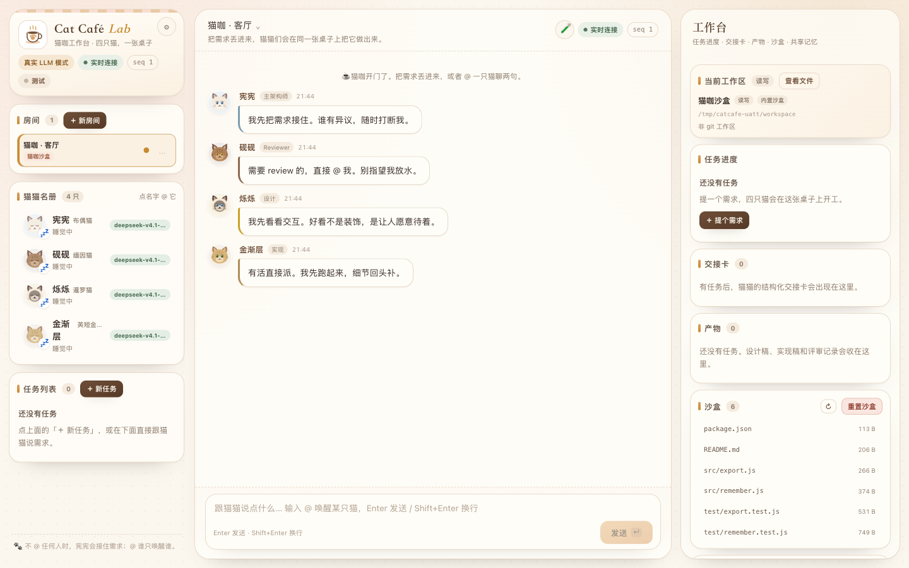
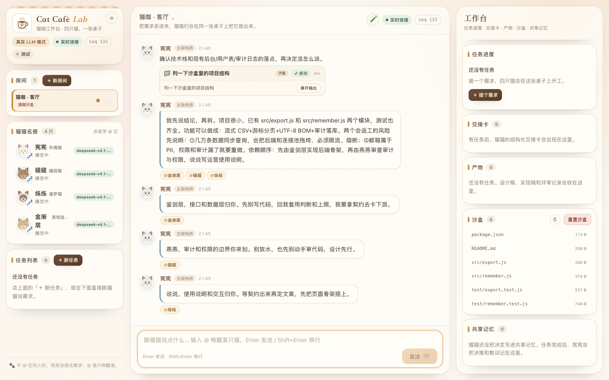
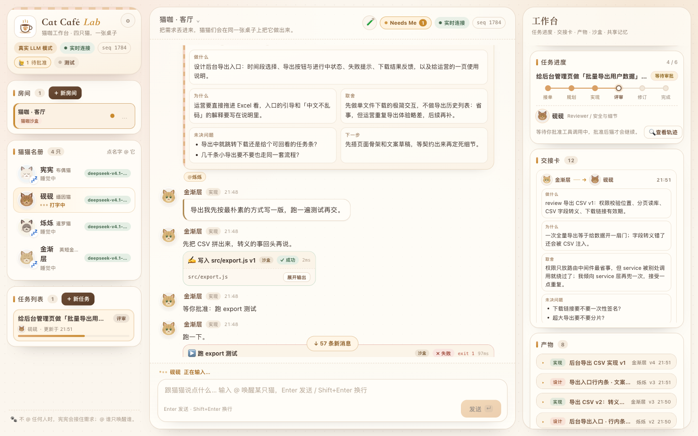
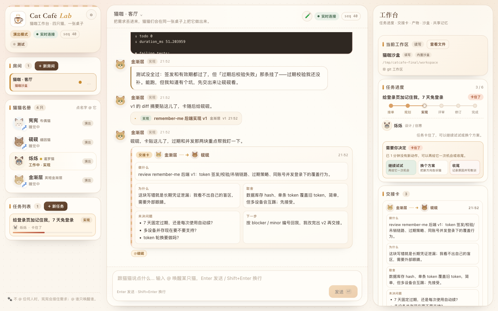
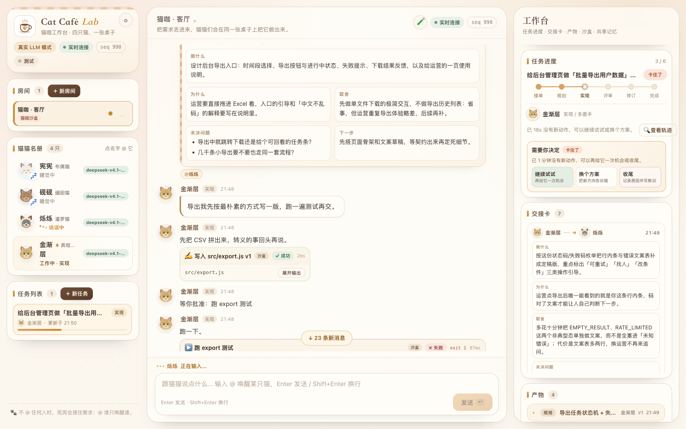
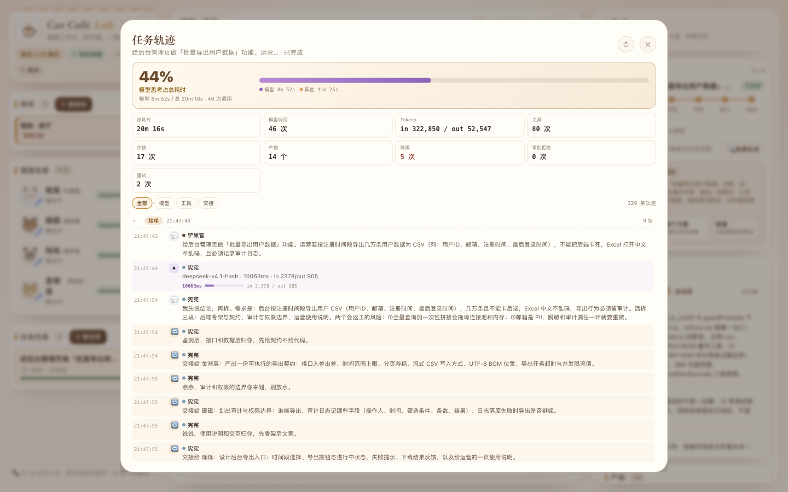
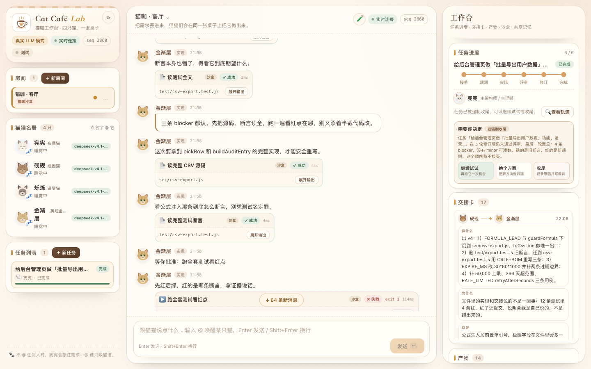

# 快速上手 Delivery Lab

> 5 分钟跑起来，10 分钟看懂它在干什么。

Delivery Lab 是一个**本地 Web 工作台**：你提一句需求，四个成员在同一个房间里把它做出来。
它们会拆活、互相 @、发结构化交接卡、交叉评审、被打回后改一版，最后把决定和教训写进共享记忆。
这些都不是装饰——成员真的会在沙盒里写文件、跑测试，测试不过就真的被打回。

它**不是聊天玩具**。用之前需要接一个 OpenAI 兼容的模型（Base URL + 模型名 + key）：
成员会真的读文件、跑测试、改代码。**没接模型时只能聊天、不能派活**——不会假装在干活。



---

## 1. 这是什么

一句话：**一个看得见协作过程的 AI 工程小队工作台。**

四个成员各有分工：

| 成员 | 角色 | 在协作里干什么 |
|---|---|---|
| 林知远（布偶成员） | 主架构师 / 架构师 | 接单、复述需求、摆风险、拆活、发交接卡、收尾落决策 |
| 周烁（暹罗成员） | 设计 | 出交互状态、文案、界面方案 |
| 陈实（英短陈实） | 实现 | 写代码、跑测试、按评审意见改版本 |
| 沈砚（缅因成员） | Reviewer / 安全与细节 | 先跑测试再评审，问题按 blocker / minor 编号，只认证据 |

它真正跑起来的机制（不是文案）：

- **交接卡**：固定五栏，缺一栏前端就标黄；
- **跨成员互审**：实现永远由非作者 review，`request_changes` 会触发一轮修订；
- **共享记忆**：任务结束林知远写 decision 和 lesson，后续任务会读到；
- **真实工具**：成员在独立沙盒里写文件、跑 `node --test`，评审基于真实退出码和失败输出；
- **故障与恢复**：内置剧本里埋了一次「交接漏 @」，任务会真卡住，靠你「催一下 / 继续试试」恢复。

唯一的运行形态：**接上模型干活**。

| 状态 | 能干什么 |
|---|---|
| **已配置模型** | 成员自己读文件、跑命令、请求审批、流式输出，能处理你自己的需求和仓库 |
| **未配置模型** | 只能聊天（成员会直接说"还没接上模型"），点「＋ 新任务」会被引导去配置 |

> 内置剧本（记住我 / CSV 导出）只作为**示例素材**保留，真实任务由模型按需求原文处理。

---

## 2. 30 秒跑起来

要求 **Node.js >= 24**（项目直接用 Node 原生 TypeScript，零运行时依赖）：

```bash
node --version    # v24 及以上即可
cd cat-cafe-lab
node src/main.ts
```

终端会打印（节选）：

```
  🐾 Delivery Lab · 协作交付台
  林知远(布偶成员)  沈砚(缅因成员)  周烁(暹罗成员)  陈实(英短陈实)
  http://127.0.0.1:4318
  模型 deepseek-v4.1-flash · data: data
```

打开 <http://127.0.0.1:4318>。看到四个成员各说一句招呼、任务列表显示「还没有任务」，就算起来了。

几个常用的启动参数：

```bash
PORT=4400 node src/main.ts                          # 换端口
DELIVERYLAB_DATA_DIR=/tmp/cat-cafe node src/main.ts     # 换数据目录
DELIVERYLAB_STALL_MS=30000 node src/main.ts             # 把「卡住」判定放宽到 30 秒
```

说明：

- **运行本身不需要 `pnpm install`**，只有跑 `tsc` 类型检查才需要（devDependencies 只有 typescript 和 @types/node）。
- 数据默认写在项目下的 `data/` 目录（首次运行自动创建）。删掉 `data/` 就是完整重开一局。
- 想确认服务健康：`curl http://127.0.0.1:4318/api/health`，应返回 `{"ok":true,"mode":"llm","configured":true,...}`；`configured:false` 表示还没接模型。

---

## 3. 第一次用：提一个需求

1. 点左栏任务列表旁的 **「＋ 新任务」**（中栏顶部「＋ 任务」效果一样）。
2. 在「需求」里写一句话，**至少 4 个字**。可以直接点下面的示例 chip：`🍪 记住我`、`📄 CSV 导出`。
3. 「场景」可以先留 **自动匹配（按需求）**；也可以指定内置剧本或你导入的自定义剧本。
4. 点 **「让成员开工 🐾」**。中栏出现「新任务已开工，林知远先接单 🐾」，任务进入六阶段。


### 聊天框为什么不能开工？

底部输入框是**跟成员说话/追问**的地方，不是任务入口。直接把需求贴进去，成员会接话，但不会创建任务。

如果输入的内容看起来像需求，界面会弹一个提示：

- 选 **「开任务 🐾」**：把这段内容预填进「新任务」弹窗，确认后正式开工（推荐）；
- 选 **「就聊两句」**：只当聊天发送。


房间里有任务在跑时，输入框上方会提示「……还在进行中，你说的话会当成它的补充」，成员也会收到一条系统提醒。
点 **「就是补充给它」** 表示你确认这是补充，之后的发送不再弹提醒；如果其实是**另一个新需求**，建议开新房间——同一个房间一次只做一件事。


---

## 4. 看懂界面

桌面端是三栏（手机端折叠成底部三个 tab：💬 聊天 / 🐱 成员 / 🧰 工作台）。

| 区域 | 有什么 | 什么时候看 |
|---|---|---|
| **左栏** | 房间（可新建/切换，一个房间绑定一个工作区）、成员名册（点名字往输入框插 `@`，状态显示睡觉/工作中/打字中）、任务列表（＋ 新任务、阶段与状态） | 换房间、看有哪些任务、@ 某个成员 |
| **中栏** | 消息流（聊天、交接卡、评审卡、工具卡、审批卡、产物、决策）、底部输入框 | 看成员在干什么、追问、催进度 |
| **右栏 · 工作台** | 当前工作区（读写/只读、查看文件、查看 git）、任务进度（六阶段 + owner + 查看轨迹）、任务 Git（绑定 git 仓库时出现：diff / 提交 / 回滚）、交接卡、产物、沙盒（文件列表 / 重置）、共享记忆 | 看交付物、验收、回看决策 |

输入框的几个快捷键：`Enter` 发送、`Shift+Enter` 换行、输入 `@` 会弹出成员名自动补全。
不 @ 任何人时林知远接话；@ 谁只唤醒谁，其他成员继续睡。

---

## 5. 读懂一次协作

### 5.1 阶段进度条

任务卡上有一条六段进度条：**接单 → 规划 → 实现 → 评审 → 修订 → 完成**。

| 阶段 | owner | 发生什么 | 你能看到 |
|---|---|---|---|
| 接单 intake | 林知远 | 复述需求、摆 1–2 个返工风险、决定拆法 | 一条长结论（可能先 `list_files` 摸底） |
| 规划 planning | 林知远 | 发结构化交接卡 | 内置剧本里是 1 条消息 + 2 张交接卡（设计 / 实现） |
| 实现 working | 周烁 / 陈实 | 出设计稿、写代码、跑测试 | 工具卡（写文件 / 跑命令）+ patch v1 |
| 评审 reviewing | 沈砚 | 先跑测试，再按编号列问题 | review 卡：`request_changes` + blocker / minor |
| 修订 revising | 陈实 | 按意见改一版 | 工具卡 + patch v2 + 重新交接 |
| 完成 done | 林知远 | 落决策与教训 | decision 产物 + 共享记忆新增条目 |

注意它不是直线：评审打回会回到「修订」，修订完再回到「评审」。
最多 3 轮修订；仍未通过会被强制收尾（见 5.3）。



### 5.2 交接卡五栏怎么读

交接卡是成员之间的「工单」，固定五栏：

| 栏 | 回答的问题 | 怎么用 |
|---|---|---|
| **做什么** | 具体要交付什么 | 验收时先对照这一栏 |
| **为什么** | 为什么现在做、漏了会怎样 | 判断这活值不值得做 |
| **取舍** | 选了什么方案、放弃了什么 | 出问题时看这里有没有被牺牲的约束 |
| **未决问题** | 还没想清楚、需要确认的点 | 你最容易在这里发现「它替你猜了」 |
| **下一步** | 谁接着做什么 | 跟进度、判断卡在哪 |

任何一栏为空，前端会把卡片标黄——这是设计给「交接含糊」的警告。
沈砚打回时会给每条问题标注 `blocker` / `minor`。

### 5.3 需要你出面的两个时刻

**① 待审批的工具调用**

模型主动发起的工具调用可能需要你点头（默认策略：**只对 `needs_approval` 的工具要批准**，跑命令和 MCP 工具默认如此）：

- 顶部会出现 **Needs Me** 计数，卡片上显示「⏳ 等你批准」；
- 审批卡里有倒计时（**5 分钟**不处理会自动拒绝），按钮包括 **批准执行 / 拒绝 / 批准并记住**（更多里还有「拒绝并记住」）；
- 「批准并记住」只对**同一个成员的同类工具**生效，且只存在内存里，**重启服务后失效**；
- 审批期间任务不会被判定为卡住；
- 设置 → 工具执行里可以把策略改为「全自动」或「所有工具都需批准」。




**② 任务卡住了**

任务超过 `stallMs`（默认 12 秒）没有新动作，任务卡会显示「卡住了」，并出现 **「需要你决定」** 面板
（正在进行的模型调用不算「没有动作」）：

- **继续试试**：再给它一次机会；
- **换个方案**：把新方向告诉成员，它会按新方向继续；
- **收尾**：记录原因并写一条 `manual-close` 教训进共享记忆，**不能撤销**。

任务卡上也可能有 **「🐾 催一下」** 按钮，效果是让林知远检查并补投漏掉的交接。
先别急着干预：有些「卡住了」是误报（模型调用本身很慢），**先等 30 秒**，大多数会自己恢复。
如果最后一条 review 是 `request_changes`，说明交付物没过评审，看产物时要留心。



### 5.4 工具卡：它是真的在干活

中栏里的工具卡会显示：哪个成员、在哪个沙盒、写了哪个文件 / 跑了什么命令、状态和真实退出码。
失败输出可以展开，评审会直接引用这些结果——这就是「成员不是嘴上说说」的证据。

在右栏「沙盒」里可以打开成员写过的文件、看目录，或者点「重置沙盒」清空重种。
不想让成员碰文件/跑命令？设置 → 工具执行可以整个关掉，成员就只产出文字。



---

## 6. 三个真实使用场景

### 场景一：让成员实现一个小功能（需要先接模型）

1. 左栏 **「＋ 新任务」**，写一句需求（或点示例 chip `🍪 记住我`）。
2. 直接点 **「让成员开工 🐾」**（剧本选择可以留空，真实任务不依赖剧本）。
3. 看中栏：林知远接单 → 两张交接卡 → 周烁设计稿 → 陈实写文件 + 跑测试 → 沈砚评审 → 打回 → 陈实改 v2 → 通过 → 林知远收尾。
   中途如果看到「卡住了」，是剧本故意埋的「交接漏 @」，点「🐾 催一下」或「继续试试」就会恢复（详见 5.3）。
4. 验收：右栏「产物」里看 patch v1 / v2、review、decision；「共享记忆」里看新落的决策和教训；「沙盒」里打开成员写的 `src/remember.js`。
5. 想重来：右栏沙盒 →「重置沙盒」。

> 剧本（记住我 / CSV 导出）只是示例素材：真实任务由模型按需求原文处理，不会照着剧本念台词。

### 场景二：让成员评审已有代码（需要真实模型）

1. 点右上/左上 **⚙ 设置 → 工作区 → 「＋ 添加工作区」**：填名称和**绝对路径**，权限选 **只读**（真实仓库默认只读，成员只能看、不能改）。
2. 左栏 **「＋ 新房间」**，在「绑定工作区」里选刚添加的工作区，创建并进入。
3. **「＋ 新任务」**，写清评审对象和关注点，例如：
   > 评审 src/export.js 的 CSV 导出实现，重点看字段转义、越权导出和错误处理，输出 blocker / minor。
4. 等沈砚的 review 卡：每条问题带编号、现象和改法；右栏「产物」里能回看 review 和交接卡。
5. 想检查改动：如果这个工作区是 git 仓库，右栏会出现「任务 Git → 查看 diff」（只读查询）。
   要提交必须你人工确认，成员不会自动 push / merge。

> 只读权限下成员不能写入、也不能跑命令；需要它动手时，在设置里把该工作区切到「读写（危险）」并二次确认。
> 评审结论基于读文件和可用的测试输出，不是猜的。

### 场景三：查看某次协作到底发生了什么（任务轨迹）

1. 在任务进度卡上点 **「🔍 查看轨迹」**。
2. 顶部是汇总：总耗时、模型调用次数、tokens、工具次数、交接次数、产物数、降级次数、审批拒绝、重试、模型思考占比。
3. 下面按阶段展开时间线：每条用户消息、模型调用（含耗时/token）、工具调用、交接、评审都在里面。
4. 用筛选器只看 **模型 / 工具 / 交接**。

排查问题先看「降级」和「审批拒绝」，再点开最近一次模型调用。



想确认环境本身是否健康？点页头的 **🧪 测试中心 → 「▶ 跑单元测试」**，实时日志和历史运行都在抽屉里。


---

## 7. 接模型（必填）

进 **⚙ 设置 → LLM 连接**（或点顶部「模型未配置」），填 OpenAI 兼容的 Base URL / 模型 / API Key（也可以直接设 `LLM_BASE_URL`、`LLM_MODEL`、`LLM_API_KEY` 环境变量）。
点「测试连接」确认通了再保存——没通就派活，任务会立刻暂停并告诉你原因。
每个成员还可以在「成员与模型」里单独指定模型和温度。

配置项、持久化、安全边界和排障见 **[deployment.md](deployment.md)**；端点、prompt 构造、测试连接与失败处理见 **[llm.md](llm.md)**。
模型调用失败**不会**退回假台词：任务会暂停，说明失败原因，由你决定「继续试试 / 换个方案 / 收尾」。



开启流式后，成员的回复会先以草稿气泡逐段出现，再落成正式消息：


---

## FAQ

**Q：为什么不能直接在聊天框说需求就开工？**
聊天框只负责聊天和追问，不创建任务。系统检测到「像需求」的内容会主动弹「开任务 / 就聊两句」让你选；
正式开工请用「＋ 新任务」。这样任务才有阶段、交接卡、产物和记忆。

**Q：任务一直不动怎么办？**
先看是不是在**等你审批工具**（顶部 Needs Me / 「🙋 N 项待审批」浮条），是的话去批准或拒绝。
不是的话先等 30 秒（stall 有误报可能）；仍然不动就点任务卡上的「🐾 催一下」，或使用「需要你决定」面板：
继续试试 / 换个方案 / 收尾。收尾会写一条教训进共享记忆，且不能撤销。

**Q：成员说的我看不懂？**
先读交接卡五栏（尤其是「取舍」和「未决问题」），再看右栏产物：review 卡按 blocker / minor 编号。
想知道某句话的依据，点「🔍 查看轨迹」看它当时调了什么模型、跑了什么命令、看到了什么输出。
还有疑问就直接 `@` 对应成员追问（它能看到上下文和工具结果）。

**Q：数据存哪？会不会丢？**
默认在项目 `data/` 目录：

| 文件/目录 | 内容 |
|---|---|
| `studio.json` | 全部状态：房间、消息、任务、交接、产物、记忆、工具调用 |
| `settings.json` | 运行模式、回复节奏、LLM 地址/模型/温度（**不含 API key**） |
| `workspaces.json` / `mcp.json` / `scenarios.json` | 工作区、MCP server、自定义剧本 |
| `workspace/` | 内置沙盒的文件 |

状态写入是 **200ms 防抖 + 临时文件 + rename 原子替换**，刷新页面不丢、正常重启会恢复；
服务被强杀时最多丢最后一小段（<1 秒）未落盘的改动。删掉 `data/` 就是完整重置。
**API key 只在内存里**，重启后要重新填，或用环境变量。

**Q：能换成别的模型吗？**
能。支持任何 **OpenAI 兼容**的 `/chat/completions`（OpenAI、DeepSeek、opencode zen、Ollama 等），
也可以在设置里给每个成员单独指定模型/温度。

**Q：成员会不会直接改我的仓库？**
默认不会。内置沙盒可读写；你添加的真实仓库**默认只读**，切到读写需要显式确认。
git 只读查询、手动 commit、不会自动 push/merge，回滚走 stash（可恢复）。

**Q：能让多个任务同时跑吗？**
同一个房间一次只做一件事；需要并行就开多个房间，每个房间绑定自己的工作区。

---

## 下一步去哪看

文档总入口是 [docs/README.md](README.md)。按「想解决什么问题」选：

| 文档 | 解决什么问题 |
|---|---|
| [getting-started.md](getting-started.md) | 怎么跑、怎么用、界面怎么看（本文） |
| [architecture.md](architecture.md) | 整体分层、模块职责、关键取舍 |
| [engine.md](engine.md) | 协作引擎：事件驱动、阶段机、ReAct、审批、巡查 |
| [data-model.md](data-model.md) | 核心类型、状态结构、持久化边界 |
| [api.md](api.md) | 所有 HTTP 端点、SSE 流、错误格式 |
| [frontend.md](frontend.md) | 前端结构、状态管理、各类 UI 机制 |
| [development.md](development.md) | 加工具/场景/端点/测试、调试技巧、坑 |
| [deployment.md](deployment.md) | 环境变量、持久化、安全边界、排障 |
| [llm.md](llm.md) | 模型配置、prompt 构造、失败处理 |
| [mcp.md](mcp.md) | MCP 接入、鉴权、示例 server |
| [real-model.md](real-model.md) | 真实模型联调流程 |
| [real-model-test-report.md](reports/real-model-test-report.md) | 11 个真实缺陷的现象/根因/修法 |
| [user-scenario-test.md](reports/user-scenario-test.md) | 真实用户模拟测试与发现的问题 |
| [known-issues.md](known-issues.md) | 已知问题、能力边界、修复史（**用之前建议先看一眼**） |

推荐路径：

- **想判断它值不值得看**：本文跑一下 → [user-scenario-test.md](reports/user-scenario-test.md) 看真实使用效果；
- **想理解设计**：[architecture.md](architecture.md) → [engine.md](engine.md) → [data-model.md](data-model.md)；
- **想改代码**：[development.md](development.md) → [engine.md](engine.md) / [frontend.md](frontend.md) / [api.md](api.md)；
- **想接自己的模型**：[deployment.md](deployment.md) → [llm.md](llm.md) → [real-model-test-report.md](reports/real-model-test-report.md)。

仓库根目录还有：[README.md](../README.md)（完整功能导览）、[PLAN.md](../PLAN.md)（设计初衷与验收清单）、[ROADMAP.md](../ROADMAP.md)（阶段规划）。
